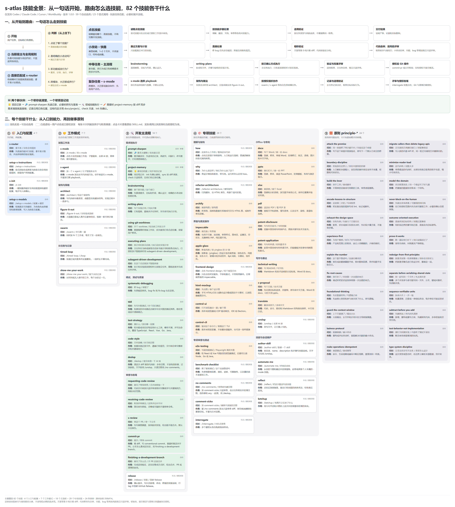

<p align="center">
  
</p>

<h1 align="center">s-atlas 中文技能</h1>

<p align="center"><strong>把日常写代码的方式，写成技能。</strong></p>

<p align="center">先磨方案、再写计划、按计划做、审查后收尾；排错讲证据，改动要验证。<br />支持 Codex、Claude Code、Cursor、WorkBuddy。</p>

<p align="center">当前版本 1.0.0，共 <strong>82</strong> 个技能：59 个按描述自动选用，23 个需点名调用。</p>

<p align="center">
  <a href="#安装">安装</a> ·
  <a href="#使用">使用</a> ·
  <a href="#技能一览">技能一览</a> ·
  <a href="docs/architecture.md">架构说明</a> ·
  <a href="https://github.com/Acefake/s-skills/releases/latest">发行版</a>
</p>

---

## 安装

**Claude Code**

```text
/plugin marketplace add Acefake/s-skills
/plugin install s-atlas@s-skills
```

**Codex**

```text
codex plugin marketplace add Acefake/s-skills
```

再到应用的插件管理入口安装 `s-atlas`。

**Cursor**：从插件市场导入 `https://github.com/Acefake/s-skills`，选择 `s-atlas`。

**Codex 本项目、WorkBuddy**：克隆仓库后在 Windows PowerShell 运行。

```powershell
git clone https://github.com/Acefake/s-skills.git
cd s-skills
powershell -NoProfile -File scripts/install_local_skills.ps1                     # Codex，只对本项目生效
powershell -NoProfile -File scripts/install_local_skills.ps1 -HostName workbuddy # WorkBuddy，只支持 Windows 本机项目
```

脚本把技能链接到 `.agents/skills/`（Codex）或 `.codebuddy/skills/`（WorkBuddy），重复执行不覆盖已有文件。WorkBuddy 没有上架市场，也不同步云端个人技能库。各宿主的入口以实际界面为准，安装或更新后开新会话。宿主差异见 [宿主适配](plugins/s-atlas/HOSTS.md)。

## 初始化

装好后点名一次 `s-init`（`/s-atlas:s-init`）：它按顺序同步全局技能规则和模型配置，每步写入前都会问你。也可以单独用 `setup-s-instructions`、`setup-s-models`。

- 全局规则写入：Codex 的 `AGENTS.md`，Claude Code 的 `~/.claude/CLAUDE.md`，WorkBuddy 的 `~/.codebuddy/CODEBUDDY.md`；Cursor 用全局 User Rules。规则正文见 [AGENTS.md](plugins/s-atlas/AGENTS.md)。
- 只在你点名时写入。平时每个会话只读检查一次，过期会提醒。新会话才生效。
- 模型配置按当前宿主实际可用的模型，推荐轻量、常规、复杂三档，不固定型号。

## 使用

点名技能，并说清目标和完成条件：

```text
用 s-mode 修复这个问题，复现后定位原因，修完运行实际流程验证。
用 how 解释这个模块的入口、数据流和关键文件。
用 impeccable 检查这个设置页，并给出具体改进。
```

支持插件命令的宿主用 `/s-atlas:技能名`，Codex 在技能选择器里选。自动选用按描述匹配，不保证每轮触发；点名的技能不会自己运行。

| 我想做什么 | 用 |
|---|---|
| 修 bug、报错、结果不对 | `systematic-debugging` |
| 做新功能、改行为 | `brainstorming`，再 `writing-plans` |
| 按写好的计划做 | `executing-plans` 或 `subagent-driven-development` |
| 提交、开 PR | `commit-pr` |
| 审 PR、分支或本地改动 | `s-review` |
| 写 README、文档、RFC | `technical-writing` |
| 做页面、改界面 | `impeccable` |
| Word、幻灯片、表格、PDF | `docx`、`pptx`、`xlsx`、`pdf` |
| 发版 | `release` |
| 拿不准 | `s-router` |

## 验证分档

按改动定档，同一份代码已验证就复用，不重跑。代码改动交付前先自审，第 2 档以上再加只读独立评审。

| 档 | 适用 | 验证 |
|---|---|---|
| 0 | 文案、注释、文档措辞、样式数值、配置值；只读任务；用户说不用测 | 不跑测试，看 diff |
| 1 | 意图明确、1–2 个文件且不改接口、数据结构或依赖的小改动 | lint 或类型检查，加已有测试 |
| 2 | 修 bug、加功能、改行为 | 有便宜稳定的测试点就先写失败测试，再验证所在模块 |
| 3 | 跨模块、改接口或依赖、迁移；非第 0 档的提交或合并前 | 全量测试一次 |

提交、推送、改写历史、外部消息和清理工作区，都只按你已有的授权执行。细则见 [s-router](plugins/s-atlas/skills/s-router/SKILL.md)。

## 钩子（仅 Claude Code）

装上插件后自动注册，只加提醒或请求确认，不改写你的输入：

- 会话开始：记下插件版本，检查全局技能提示词是否过期。
- 每条提示词附一段评估说明，含糊时才加载 `prompt-sharpen`；以 `*`、`#`、`/` 开头的不介入。
- 长时间运行的命令：提醒放到后台。
- 强制推送、`--no-verify`、`reset --hard`、`git clean`：先请你确认。

说明和关闭方法见 [钩子说明](plugins/s-atlas/hooks/README.md)。Codex 要手动配置，见 [Codex 配置](plugins/s-atlas/skills/prompt-sharpen/references/hook.md)。

## 技能一览

[](docs/s-skills-route.png)

[全景图源（HTML）](docs/architecture/s-atlas-panorama.html) · [架构说明](docs/architecture.md) · [组件关系图](docs/architecture/s-atlas.html)

「点名」的技能在 frontmatter 里带 `disable-model-invocation: true`，由你点名或已授权的工作流派发。

### 入口与配置（4）

| 技能 | 调用 | 用途 |
|---|---|---|
| `s-router` | 自动 | 日常先查该用哪个技能 |
| `setup-s-instructions` | 点名 | 显式初始化、检查或修复当前宿主的全局技能提示词 |
| `s-init` | 点名 | 显式一键初始化：先同步全局技能提示词，再配置模型，每步写入前确认 |
| `setup-s-models` | 自动 | 给各角色配模型和预算 |

### 工作模式（7）

| 技能 | 调用 | 用途 |
|---|---|---|
| `s-mode` | 点名 | 点名才走的加强工作流 |
| `s-agent` | 点名 | `s-mode` 派出去写代码的子智能体 |
| `architect` | 点名 | 动手前定类型和模块边界 |
| `figure-it-out` | 点名 | 没有现成 playbook 时现做一套 |
| `swarm` | 点名 | 并行覆盖、比赛、分片验证 |
| `timed-loop` | 点名 | 按通过/失败条件反复醒来 |
| `show-me-your-work` | 点名 | 长时间运行留下决定记录 |

### 开发主流程（18）

| 技能 | 调用 | 用途 |
|---|---|---|
| `prompt-sharpen` | 自动 | 需求含糊时先读项目、再问清缺口，改写成能直接执行的提示词 |
| `project-memory` | 自动 | 在项目里建立并维护架构、规范、决策记录，改动后按 diff 只更新受影响的部分 |
| `brainstorming` | 自动 | 做功能前先把方案磨清 |
| `writing-plans` | 自动 | 把活写成可执行计划 |
| `using-git-worktrees` | 自动 | 用 worktree 隔开工作 |
| `executing-plans` | 自动 | 按写好的计划做 |
| `subagent-driven-development` | 自动 | 用子智能体推进计划 |
| `systematic-debugging` | 自动 | 按证据排错 |
| `tdd` | 自动 | 修 bug 时有便宜的测试点就先写失败测试 |
| `test-strategy` | 自动 | 定每个行为在哪一层测、用什么工具；覆盖 TS/React、Vue、Go、Java |
| `code-style` | 自动 | 按模块就近放文件、写文档注释、质量底线；覆盖 TS/React、Vue、Go、Java |
| `deslop` | 自动 | 提交前清掉代码里的 AI 味 |
| `requesting-code-review` | 自动 | 发起代码审查 |
| `receiving-code-review` | 自动 | 处理审查意见 |
| `s-review` | 自动 | 中文代码审查：审 PR、分支或本地改动，带出处和严重程度，给合并结论 |
| `commit-pr` | 自动 | 看 diff，写提交说明，推送并开 PR。集成方式还没定用 `finishing-a-development-branch` |
| `finishing-a-development-branch` | 自动 | 收尾开发分支 |
| `release` | 点名 | 显式发版：确认版本，写只含新增、改动、修复的发版说明，打 tag 并创建 GitHub Release |

### 专项技能（29）

| 技能 | 调用 | 用途 |
|---|---|---|
| `how` | 点名 | 改之前讲清代码怎么串 |
| `why` | 点名 | 查为什么这样设计 |
| `refactor-architecture` | 点名 | 找浅模块和耦合，出 HTML 报告，再逐个追问定案 |
| `archify` | 自动 | 画架构图、流程图、时序图、ER 图等，出可交互单文件 HTML，需要 Node 18+ |
| `impeccable` | 自动 | 做页面、改界面、做设计审查；`optimize` 守交互性能预算（INP、长任务、帧率、包体积） |
| `apple-glass` | 自动 | 影盒的界面语言：深色优先、实色卡片、玻璃只给浮动控件、令牌化，附令牌、材质和样式检查脚本 |
| `frontend-design` | 点名 | 点名时给一份有主见的视觉方向，不带检查脚本 |
| `html-mockup` | 自动 | 手写 HTML/CSS 出静态设计稿，Playwright 截图交付；真实界面截图用 `control-ui` |
| `control-ui` | 自动 | 在真浏览器里操作界面取证 |
| `control-cli` | 自动 | 在本地操作命令行或 TUI |
| `e2e-testing` | 自动 | 用 Playwright 写稳定的端到端测试，修不稳定的测试 |
| `benchmark-checklist` | 点名 | 报告性能数字前先审核 |
| `no-comments` | 点名 | 只读审查注释，由父任务核实后修改 |
| `comment-sicko` | 点名 | 只读审查注释的子智能体，交由父任务核实修改 |
| `interrogate` | 点名 | 多模型对抗审查 |
| `docx` | 自动 | 创建、修订、批注和阅读 Word。中文设置 `w:eastAsia` |
| `pptx` | 自动 | 用 HTML 或模板做幻灯片。中文指定 CJK 字体并留余量 |
| `xlsx` | 自动 | 带公式的工作簿，保存后用 LibreOffice 重算 |
| `pdf` | 自动 | 提取、填表、合并拆分、OCR 和新建 PDF |
| `patent-disclosure` | 自动 | 做中国发明专利挖掘、查新、写技术交底书，输出 Markdown 和 Word |
| `patent-application` | 自动 | 起草中国发明专利申请文件（摘要、权利要求书、说明书、附图）并输出 Word |
| `technical-writing` | 自动 | 写 README、写文档、RFC、PR 说明的句子。Word 用 `docx` |
| `s-proposal` | 自动 | 写中文方案：先问清目标，列提纲，再按固定结构起草打磨 |
| `translate` | 自动 | 中英翻译，可中英对照。代码、命令、路径不译 |
| `unslop` | 点名 | 去掉文字里的 AI 腔 |
| `author-skill` | 点名 | 按规范写或大改 SKILL.md |
| `automate-me` | 点名 | 从你的习惯和最近对话里提炼，起草或更新个人专属的 `-mode` 技能 |
| `reflect` | 点名 | 把这次对话的教训改进技能 |
| `ketchup` | 点名 | 补上你离开后这次对话的变化 |

### 原则 principle-*（24）

<details>
<summary>24 条，都按描述自动选用</summary>

| 技能 | 调用 | 用途 |
|---|---|---|
| `principle-attack-the-premise` | 自动 | 同一前提反复修不好就先验证前提 |
| `principle-boundary-discipline` | 自动 | 区分输入校验与业务约束，避免重复防御 |
| `principle-build-the-lever` | 自动 | 不简单的活做成可再跑的工具 |
| `principle-encode-lessons-in-structure` | 自动 | 第二次出现的教训写成检查 |
| `principle-exhaust-the-design-space` | 自动 | 没先例时先做几个方案再选 |
| `principle-experience-first` | 自动 | 取舍时先顾使用体验 |
| `principle-explain-the-number` | 自动 | 相信数字前先解释它量的是什么 |
| `principle-fix-root-causes` | 自动 | 在第一次出错的地方修 |
| `principle-foundational-thinking` | 自动 | 写逻辑前先定数据结构 |
| `principle-guard-the-context-window` | 自动 | 大块内容交给子智能体 |
| `principle-laziness-protocol` | 自动 | 能删就删，只留最小改动 |
| `principle-make-operations-idempotent` | 自动 | 崩溃重试后仍落到同一结果 |
| `principle-migrate-callers-then-delete-legacy-apis` | 自动 | 迁完调用方再删旧 API |
| `principle-minimize-reader-load` | 自动 | 减少读者要记住的层数 |
| `principle-model-the-domain` | 自动 | 把领域写进一个结构 |
| `principle-never-block-on-the-human` | 自动 | 可撤销的事先做再给人看 |
| `principle-outcome-oriented-execution` | 自动 | 迁移直接走向目标结构 |
| `principle-prove-it-works` | 自动 | 完成前对照真实结果验证 |
| `principle-redesign-from-first-principles` | 自动 | 新需求按第一性原理重做设计 |
| `principle-separate-before-serializing-shared-state` | 自动 | 并发写入前先去掉共享 |
| `principle-sequence-verifiable-units` | 自动 | 拆成可验证的小步 |
| `principle-subtract-before-you-add` | 自动 | 先删多余的再加 |
| `principle-test-behavior-not-implementation` | 自动 | 测使用者能看到的行为 |
| `principle-type-system-discipline` | 自动 | 让非法状态无法表示 |

</details>

Office、PDF 类技能需要 Python 3.12、Node.js（在技能目录里 `npm install` 一次）、LibreOffice、poppler；读 docx 要 pandoc，中文渲染检查要 Noto CJK，扫描件 OCR 要 Tesseract。`archify` 需要 Node 18+。

## 维护

技能只放在 `plugins/s-atlas/skills/<英文名>/SKILL.md`。不再用的技能直接删，名字记进 `scripts/marketplace_lib.py` 的 `RETIRED_SKILLS`，要找回去翻 git 历史。校验脚本需要 Python 3.10 及以上。

```text
python -m pip install -r requirements-dev.txt
python scripts/update_skill_policies.py
python scripts/bump_plugin_version.py s-atlas
python scripts/check_marketplace.py
python -m unittest discover -s scripts -p "test_*.py"
claude plugin validate plugins/s-atlas
git config core.hooksPath scripts/git-hooks   # 提交前自动检查版本和哈希
```

- 非补丁版本（如 1.1.0）：先改锁文件和已登记清单里的版本号，再跑 `scripts/check_marketplace.py`；补丁版本用 `bump_plugin_version.py`。
- 发版点名 `release`：确认版本，写只含新增、改动、修复的说明，打 tag 并创建 GitHub Release。
- 新增自动选用的技能，先在 `scripts/trigger_cases.json` 补一条触发用例；改了描述就跑触发评测（会产生实际调用，不进 CI）：`python scripts/eval_triggers.py --model haiku --jobs 6 --repeat 3`。
- 宿主里的真实行为用 [evals](plugins/s-atlas/evals/README.md) 的 `claude plugin eval` 用例检查。
- 改名对照与回滚见 [RENAMES.md](RENAMES.md)。

## 许可证

s-atlas 按 [LICENSE](plugins/s-atlas/LICENSE) 发布。个别技能附带的组件许可证：

- [`brainstorming`、`writing-plans` 等开发流程技能](plugins/s-atlas/LICENSE-dev-workflow)
- [`frontend-design`](plugins/s-atlas/LICENSE-frontend-design)
- [`refactor-architecture`](plugins/s-atlas/LICENSE-refactor-architecture)
- [`prompt-sharpen`](plugins/s-atlas/LICENSE-prompt-improver)：改编自 [claude-code-prompt-improver](https://github.com/severity1/claude-code-prompt-improver)，MIT，Copyright (c) 2025 severity1
- [`project-memory`](plugins/s-atlas/LICENSE-update-memory)：改编自 [update-memory](https://github.com/ondatra-ai/awesome-claude-mcp)，MIT，Copyright (c) 2025 Philosophical Ondatra
- [`deslop`、`control-cli`、`control-ui`](plugins/s-atlas/LICENSE-deslop-control)
- [`docx`、`pptx`、`xlsx`、`pdf`](plugins/s-atlas/LICENSE-document-skills)
- [`impeccable`：许可证](plugins/s-atlas/LICENSE-impeccable) · [声明](plugins/s-atlas/NOTICE-impeccable.md)
- [`archify`：许可证与声明](plugins/s-atlas/skills/archify/)
- [`patent-disclosure`](plugins/s-atlas/skills/patent-disclosure/LICENSE)：改编自 [cn-patent](https://github.com/Zaoqu-Liu/cn-patent)，MIT，Copyright (c) 2026 Zaoqu Liu
- [`patent-application`](plugins/s-atlas/skills/patent-application/LICENSE)：改编自 [cnipa-patent-writer](https://github.com/fnjialun/cnipa-patent-writer)，MIT，Copyright (c) 2026 fnjialun
