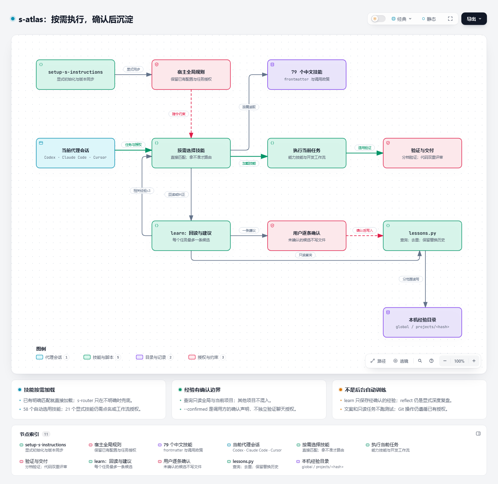

# s-atlas 中文技能


Acefake 的中文 AI 编程技能库，插件名 `s-atlas`，当前版本 1.7.27，共 **79** 个技能。

它把我日常写代码的方式写成了技能：先磨方案、再写计划、按计划做、审查后收尾；排错讲证据，改动要验证；界面要干净克制，代码按模块放、写文档注释。装上之后，Codex、Claude Code、Cursor、WorkBuddy会按你说的话自动挑对应的技能。

技能目录名和 frontmatter 的 `name` 一致，都是英文小写 kebab-case。描述以中文触发词开头，主要正文使用中文，部分模板和 playbook 使用英文。

## 安装

### Codex 本项目开发

克隆仓库后，在 Windows PowerShell 中运行：

```powershell
git clone https://github.com/Acefake/s-skills.git
cd s-skills
powershell -NoProfile -File scripts/install_local_skills.ps1
```

脚本把活跃技能链接到本项目的 `.agents/skills/`。重新打开项目会话后使用；修改源文件后无需重复复制技能。该方式只对本项目生效。

### 插件市场

Claude Code 在聊天中运行：

```text
/plugin marketplace add Acefake/s-skills
/plugin install s-atlas@s-skills
```

Codex 在终端添加市场，再在应用的插件管理入口安装 `s-atlas`：

```text
codex plugin marketplace add Acefake/s-skills
```

Cursor 从插件市场导入 `https://github.com/Acefake/s-skills`，选择 `s-atlas`。各宿主的命令支持与入口以实际界面为准。安装或更新后开启新会话，确认技能路径和版本。

### WorkBuddy 本机项目安装

克隆仓库后，在 Windows PowerShell 中运行：

```powershell
powershell -NoProfile -File scripts/install_local_skills.ps1 -HostName workbuddy
```

脚本使用官方兼容的项目 `.codebuddy/skills/` 目录，链接完整源码；保留仓库位置，重新打开该项目会话确认发现技能。重复执行不重复创建，已有用户文件不会被覆盖。此入口只支持 Windows 本机项目；没有上架 WorkBuddy 市场，也不自动同步云端个人技能库。宿主工具与模型能力以当前会话为准，详见 [WorkBuddy 参考](plugins/s-atlas/skills/s-router/references/workbuddy-tools.md)。

### 让技能自动生效

安装后显式调用 `setup-s-instructions`，初始化当前宿主的全局技能提示词。Codex 在技能选择器中选择它；支持插件命令的宿主可用 `/s-atlas:setup-s-instructions`。

Codex 使用实际 `CODEX_HOME` 下生效的 `AGENTS.override.md` 或 `AGENTS.md`；Claude Code 使用实际 `CLAUDE_CONFIG_DIR` 下的 `CLAUDE.md`，默认 `~/.claude/CLAUDE.md`。WorkBuddy 使用用户级兼容文件 `~/.codebuddy/CODEBUDDY.md`，脚本参数为 `--host workbuddy`，默认只读检查，明确初始化时加 `--apply`。初始化从当前插件的 `AGENTS.md` 和 `plugin.json` 生成带版本的完整规则。已知旧规则原位迁移，保留用户其他内容和首份备份，重复执行不会重复添加。版本或正文变化时只读检查报告过期，显式初始化或更新后同步。Cursor 使用全局 User Rules；没有可用的设置编辑工具时，技能给出完整提示词供粘贴，并标记尚未配置。

日常使用技能时，每个主会话只读检查一次；缺失、过期或无法确认时提醒，继续原任务。安装与普通技能调用不会自动改写全局配置。全局规则通常在新会话生效。

初始化提示词的当前正文见 [`AGENTS.md`](plugins/s-atlas/AGENTS.md)；[`AGENTS-snippet.md`](plugins/s-atlas/AGENTS-snippet.md) 仅作手动引导及旧配置识别。

## 经验学习

`learn` 在用户纠正、重复错误或已验证的重要结论出现时，先检查已有规则和经验，每个任务最多提出一条学习建议。普通成功、一次性要求和重复经验不记录。你确认具体内容与范围后才保存；未确认的候选不写文件。

经验保存在本机 `~/.s-atlas/lessons`，全局与项目分开，四个支持的宿主可共用；实际项目任务按意图回读最多三条，其他项目的记录不会混入。重复保存不新增，修订须确认并引用被替代记录，旧文件保留为历史。经验不能覆盖当前指示和实际代码，不代表模型训练或后台自动学习。`reflect` 仍负责点名后的深度复盘与技能修改。

例如：`记住这次在当前项目保存后必须回读验证的经验`，或 `先查本项目以前关于 Vue 保存的经验`。安装新版后，全局提示词的新增规则仍通过显式调用 `setup-s-instructions` 同步，安装和普通技能调用不会自动改全局规则。

## 架构与技能路由

[](docs/s-skills-route.png)

[全景卡片图源（HTML）](docs/architecture/s-atlas-panorama.html) · [完整说明](docs/architecture.md) · [组件关系补充图](docs/architecture/s-atlas.html)

主图沿用白底全景卡片风格：上半部分展示从任务到技能的路由，下半部分按入口与配置、工作模式、开发主流程、专项技能和原则分栏，完整列出 79 个技能的触发例子与职责。浅色实底表示可自动选用，白底虚线表示需点名或已有授权派发。点击图片可放大，HTML 卡片链接到对应技能源码。

- **任务主线：** 当前宿主读取全局约定与技能描述。已有明确匹配就直接加载，拿不准才用 `s-router`；按任务进入直接处理、方案与计划、调试或只读交付。
- **交付边界：** 验证强度按档位，代码改动先自审再做只读独立评审。已有验证结果可复用，Git 操作只按已有授权执行。
- **经验支线：** `learn` 按需回读全局与当前项目经验；遇到纠正、重复错误或已验证的重要结论时，最多提出一条建议，逐条确认后才写入。
- **两个显式入口：** `setup-s-instructions` 负责初始化与同步全局规则；`reflect` 负责深度复盘和技能修改。日常自检和学习建议不会自动替代这两个入口。

小改动跳过方案和计划；子代理实现仍需授权，不能把代码独立评审授权扩展成并行开发授权。需要隔离时使用 `using-git-worktrees`，优先复用适合的现有工作区并保留已有修改。

### 验证与交付边界

| 档位 | 适用情况 | 验证方式 |
|---|---|---|
| 0 | 文案、注释、文档措辞、样式数值、配置值；只读任务；用户说不用测 | 不跑测试，修改内容后检查 diff |
| 1 | 意图明确、1–2 个文件且不改接口、数据结构或依赖的小改动 | lint 或类型检查，加改动文件已有测试 |
| 2 | 修 bug、加功能、改行为 | 有便宜稳定测试点时使用 TDD，再验证所在模块 |
| 3 | 跨模块、改接口或依赖、迁移；非第 0 档的提交或合并前 | 全量测试一次 |

复用同一代码上仍有效的验证结果。明确属于第 0 档的任务不因提交而升级。live 场景和性能检查按需安排，不适用时注明原因；人工验收沿用已有要求，不强制同时提供截图和视频。

只读审查不改文件、不清理代码、不运行测试。任务验收覆盖相关提交、暂存、未暂存和新文件。提交、推送、改写历史、外部消息及工作区清理均遵循已有授权，完成实现本身不授权这些操作。

### 代码质量原则

- 复用已有实现和项目约定，先选能解决问题的最小改动。
- 每次代码交付前自审完整任务差异和关键调用方，报告发现与剩余风险。小改动、不提交、不跑测试都不跳过；自审、测试、清理和独立评审各自完成。所有代码修改，包括简单小改动，默认加只读 subagent 独立评审。小任务聚焦差异和直接调用方，高风险任务扩大范围；纯文案、注释、样式数值和简单配置只看 diff，无法委派时明确报告。
- 输入格式在入口校验；业务不变量、权限和可变状态由负责的操作保证，不逐层复制检查，也不无条件信任内部状态。
- 抽象是否保留取决于职责和理解成本，不取决于文件数、调用方数或适配器数量。局部清楚的分支无需改成框架。
- 合并模块先说明共享领域知识、耦合问题与收益，再按依赖选择验证方式。存在测试替身不代表应该合并。
- 删除旧测试前核对正常行为、边界、失败路径和回归覆盖，只删除被等效替代或绑定旧实现细节的部分。
- `deslop` 在实现范围内清理冗余；注释审查保留必要契约和约束，由父任务核实后修改。

## 使用

点名技能，并说明目标和完成条件：

```text
用 s-mode 修复这个问题，复现后定位原因，修完运行实际流程验证。
用 how 解释这个模块的入口、数据流和关键文件。
用 impeccable 检查这个设置页，并给出具体改进。
```

支持插件命令的宿主也可以使用 `/s-atlas:技能名`，例如 `/s-atlas:s-mode`。Codex 可在技能选择器中选择相应技能。

原则、`learn`、`setup-s-models`、`impeccable`、`technical-writing`、`docx`、`pptx`、`xlsx`、`pdf`、`patent-disclosure`、`patent-application`、`commit-pr`、`translate`、`s-proposal`、`s-review`，以及开发流程技能（`brainstorming` 到 `finishing-a-development-branch`）可以按描述自动选用。`s-review` 审 PR、分支或本地改动，默认只出报告。`frontend-design` 只在点名时使用，日常做界面走 `impeccable`。工作模式和并行审查等复杂流程需要点名。自动选用不表示每轮都会执行；能不能做到还取决于宿主提供的工具。

## 我想做什么

| 我想做什么 | 用哪个 skill |
|---|---|
| 修 bug、报错、结果不对 | `systematic-debugging` |
| 回读经验、记住纠正或重复错误的教训 | `learn`，保存前逐条确认 |
| 有便宜的测试点，先写失败测试再修 | `tdd` |
| 做新功能、改行为 | `brainstorming`，然后 `writing-plans` |
| 按写好的计划做 | `executing-plans` 或 `subagent-driven-development` |
| 做完了，还没决定合并、开 PR、留着还是丢掉 | `finishing-a-development-branch` |
| 写提交说明、提交、开 PR | `commit-pr` |
| 审 PR、分支或本地改动 | `s-review` |
| 写或改 Word（.docx） | `docx` |
| 做幻灯片（.pptx） | `pptx` |
| 做表格、公式（.xlsx） | `xlsx` |
| 读、填或生成 PDF | `pdf` |
| 写技术交底书、专利挖掘、查新 | `patent-disclosure` |
| 写发明专利申请文件、权利要求书、说明书 | `patent-application` |
| 写 README、写文档、RFC、PR 说明的句子 | `technical-writing` |
| 中文和英文互译，或中英对照 | `translate` |
| 点名 how 讲解代码 | `how`；未点名时直接讲解 |
| 问为什么这样设计 | `why` |
| 做页面、改界面、看卡顿 | `impeccable` |
| 点名要一份有主见的视觉方向 | `frontend-design` |
| 按影盒 / Apple TV 风格做界面 | `apple-glass` |
| `html-mockup` | 手写 HTML/CSS 出静态设计稿，Playwright 截图交付；真实界面截图用 `control-ui` |
| 改界面前先出设计图、做固定尺寸素材 | `html-mockup` |
| 文件放哪、文档注释、代码质量 | `code-style` |
| 决定在哪一层测 | `test-strategy` |
| 写或修 Playwright 端到端测试 | `e2e-testing` |
| 点名走加强工作流 | `s-mode` |
| 找浅模块、出架构报告 | `refactor-architecture` |
| 画架构图、流程图、时序图、ER 图 | `archify` |
| 提交前清代码里的 AI 味 | `deslop` |
| 做事时的取舍（能删就删、先验证、别卡着等人等） | 24 条 `principle-*`，按描述自动选用 |

- [全部活跃技能](plugins/s-atlas/skills/)
- [工作模式](plugins/s-atlas/skills/s-mode/SKILL.md)
- [模型设置](plugins/s-atlas/skills/setup-s-models/SKILL.md)
- [改名对照与回滚](RENAMES.md)
- [Codex、Claude Code、Cursor、WorkBuddy 宿主适配规则](plugins/s-atlas/HOSTS.md)

## 活跃技能

「自动」是模型按描述选用；「手点」是 frontmatter 里有 `disable-model-invocation: true`，由用户点名或已授权工作流明确派发。

### 自动选用（58 个）

| 技能 | 用途 |
|---|---|
| `learn` | 按需回读已确认经验；自动提出建议，逐条确认后保存 |
| `s-router` | 日常先查该用哪个技能 |
| `brainstorming` | 做功能前先把方案磨清 |
| `writing-plans` | 把活写成可执行计划 |
| `executing-plans` | 按写好的计划做 |
| `subagent-driven-development` | 用子智能体推进计划 |
| `systematic-debugging` | 按证据排错 |
| `requesting-code-review` | 发起代码审查 |
| `receiving-code-review` | 处理审查意见 |
| `using-git-worktrees` | 用 worktree 隔开工作 |
| `finishing-a-development-branch` | 收尾开发分支 |
| `impeccable` | 做页面、改界面、做设计审查；`optimize` 守交互性能预算（INP、长任务、帧率、包体积） |
| `apple-glass` | 影盒的界面语言：深色优先、实色卡片、玻璃只给浮动控件、令牌化，附令牌、材质和样式检查脚本 |
| `docx` | 创建、修订、批注和阅读 Word。中文设置 `w:eastAsia` |
| `pptx` | 用 HTML 或模板做幻灯片。中文指定 CJK 字体并留余量 |
| `xlsx` | 带公式的工作簿，保存后用 LibreOffice 重算 |
| `pdf` | 提取、填表、合并拆分、OCR 和新建 PDF |
| `patent-disclosure` | 做中国发明专利挖掘、查新、写技术交底书，输出 Markdown 和 Word。改编自 [cn-patent](https://github.com/Zaoqu-Liu/cn-patent)（MIT） |
| `patent-application` | 起草中国发明专利申请文件（摘要、权利要求书、说明书、附图）并输出 Word。改编自 [cnipa-patent-writer](https://github.com/fnjialun/cnipa-patent-writer)（MIT） |
| `code-style` | 按模块就近放文件、写文档注释、质量底线；覆盖 TS/React、Vue、Go、Java |
| `test-strategy` | 定每个行为在哪一层测、用什么工具；覆盖 TS/React、Vue、Go、Java |
| `e2e-testing` | 用 Playwright 写稳定的端到端测试，修不稳定的测试 |
| `tdd` | 修 bug 时有便宜的测试点就先写失败测试 |
| `setup-s-models` | 给各角色配模型和预算 |
| `archify` | 画架构图、流程图、时序图、ER 图等，出可交互单文件 HTML，需要 Node 18+ |
| `deslop` | 提交前清掉代码里的 AI 味 |
| `technical-writing` | 写 README、写文档、RFC、PR 说明的句子。Word 用 `docx` |
| `commit-pr` | 看 diff，写提交说明，推送并开 PR。集成方式还没定用 `finishing-a-development-branch` |
| `translate` | 中英翻译，可中英对照。代码、命令、路径不译 |
| `s-proposal` | 写中文方案：先问清目标，列提纲，再按固定结构起草打磨 |
| `s-review` | 中文代码审查：审 PR、分支或本地改动，带出处和严重程度，给合并结论 |
| `control-ui` | 在真浏览器里操作界面取证 |
| `control-cli` | 在本地操作命令行或 TUI |

Python 用 3.12，推荐 `uv`。docx 和 pptx 还要 Node.js（在技能目录里 `npm install` 一次）。看页面需要 LibreOffice 和 poppler。docx 阅读需要 pandoc。中文渲染检查要安装 Noto CJK（Debian/Ubuntu：`fonts-noto-cjk`）。PDF 的扫描件 OCR 另要 Tesseract。

#### 原则（24 个）

| 技能 | 用途 |
|---|---|
| `principle-laziness-protocol` | 能删就删，只留最小改动 |
| `principle-foundational-thinking` | 写逻辑前先定数据结构 |
| `principle-redesign-from-first-principles` | 新需求按第一性原理重做设计 |
| `principle-attack-the-premise` | 同一前提反复修不好就先验证前提 |
| `principle-subtract-before-you-add` | 先删多余的再加 |
| `principle-minimize-reader-load` | 减少读者要记住的层数 |
| `principle-outcome-oriented-execution` | 迁移直接走向目标结构 |
| `principle-experience-first` | 取舍时先顾使用体验 |
| `principle-exhaust-the-design-space` | 没先例时先做几个方案再选 |
| `principle-build-the-lever` | 不简单的活做成可再跑的工具 |
| `principle-model-the-domain` | 把领域写进一个结构 |
| `principle-boundary-discipline` | 区分输入校验与业务约束，避免重复防御 |
| `principle-type-system-discipline` | 让非法状态无法表示 |
| `principle-make-operations-idempotent` | 崩溃重试后仍落到同一结果 |
| `principle-migrate-callers-then-delete-legacy-apis` | 迁完调用方再删旧 API |
| `principle-separate-before-serializing-shared-state` | 并发写入前先去掉共享 |
| `principle-prove-it-works` | 完成前对照真实结果验证 |
| `principle-fix-root-causes` | 在第一次出错的地方修 |
| `principle-sequence-verifiable-units` | 拆成可验证的小步 |
| `principle-test-behavior-not-implementation` | 测使用者能看到的行为 |
| `principle-explain-the-number` | 相信数字前先解释它量的是什么 |
| `principle-guard-the-context-window` | 大块内容交给子智能体 |
| `principle-never-block-on-the-human` | 可撤销的事先做再给人看 |
| `principle-encode-lessons-in-structure` | 第二次出现的教训写成检查 |

### 手点（21 个）

| 技能 | 用途 |
|---|---|
| `setup-s-instructions` | 显式初始化、检查或修复当前宿主的全局技能提示词 |
| `frontend-design` | 点名时给一份有主见的视觉方向，不带检查脚本 |
| `s-mode` | 点名才走的加强工作流 |
| `s-agent` | `s-mode` 派出去写代码的子智能体 |
| `comment-sicko` | 只读审查注释的子智能体，交由父任务核实修改 |
| `how` | 改之前讲清代码怎么串 |
| `why` | 查为什么这样设计 |
| `architect` | 动手前定类型和模块边界 |
| `refactor-architecture` | 找浅模块和耦合，出 HTML 报告，再逐个追问定案 |
| `swarm` | 并行覆盖、比赛、分片验证 |
| `arena` | 实质设计选择下比较候选，按需采纳长处 |
| `interrogate` | 多模型对抗审查 |
| `unslop` | 去掉文字里的 AI 腔 |
| `no-comments` | 只读审查注释，由父任务核实后修改 |
| `author-skill` | 按规范写或大改 SKILL.md |
| `benchmark-checklist` | 报告性能数字前先审核 |
| `show-me-your-work` | 长时间运行留下决定记录 |
| `figure-it-out` | 没有现成 playbook 时现做一套 |
| `timed-loop` | 按通过/失败条件反复醒来 |
| `reflect` | 把这次对话的教训改进技能 |
| `ketchup` | 补上你离开后这次对话的变化 |

## 维护

技能只放在 `plugins/s-atlas/skills/<英文名>/SKILL.md`。不再用的技能直接删除，名字记进 `scripts/marketplace_lib.py` 的 `RETIRED_SKILLS`，要找回去翻 git 历史。改完后同步调用策略、更新版本并检查：

```text
python scripts/update_skill_policies.py
python scripts/bump_plugin_version.py s-atlas
python scripts/check_marketplace.py
python -m unittest discover -s scripts -p "test_*.py"
claude plugin validate plugins/s-atlas
npx skills add . --list
```

要发 1.8.0 这种非补丁版本，先改锁文件和已登记的清单里的版本号，再跑 `scripts/check_marketplace.py`。补丁版本用 `bump_plugin_version.py`。

校验覆盖市场清单、版本锁、技能名称、调用策略和本地链接。技能是否实际触发、模型是否按配置委派，仍需通过真实会话验证。

## 许可证

s-atlas 按 [LICENSE](plugins/s-atlas/LICENSE) 发布。个别技能附带的组件许可证：

- [`brainstorming`、`writing-plans` 等开发流程技能：许可证](plugins/s-atlas/LICENSE-dev-workflow)
- [`frontend-design`：许可证](plugins/s-atlas/LICENSE-frontend-design)
- [`refactor-architecture`：许可证](plugins/s-atlas/LICENSE-refactor-architecture)
- [`deslop`、`control-cli`、`control-ui`：许可证](plugins/s-atlas/LICENSE-deslop-control)
- [`docx`、`pptx`、`xlsx`、`pdf`：许可证](plugins/s-atlas/LICENSE-document-skills)
- [`impeccable`：许可证](plugins/s-atlas/LICENSE-impeccable)
- [`impeccable`：声明](plugins/s-atlas/NOTICE-impeccable.md)
- [`archify`：许可证与声明](plugins/s-atlas/skills/archify/)
- [`patent-disclosure`：许可证](plugins/s-atlas/skills/patent-disclosure/LICENSE)（改编自 [cn-patent](https://github.com/Zaoqu-Liu/cn-patent)，MIT，Copyright (c) 2026 Zaoqu Liu）
- [`patent-application`：许可证](plugins/s-atlas/skills/patent-application/LICENSE)（改编自 [cnipa-patent-writer](https://github.com/fnjialun/cnipa-patent-writer)，MIT，Copyright (c) 2026 fnjialun）
