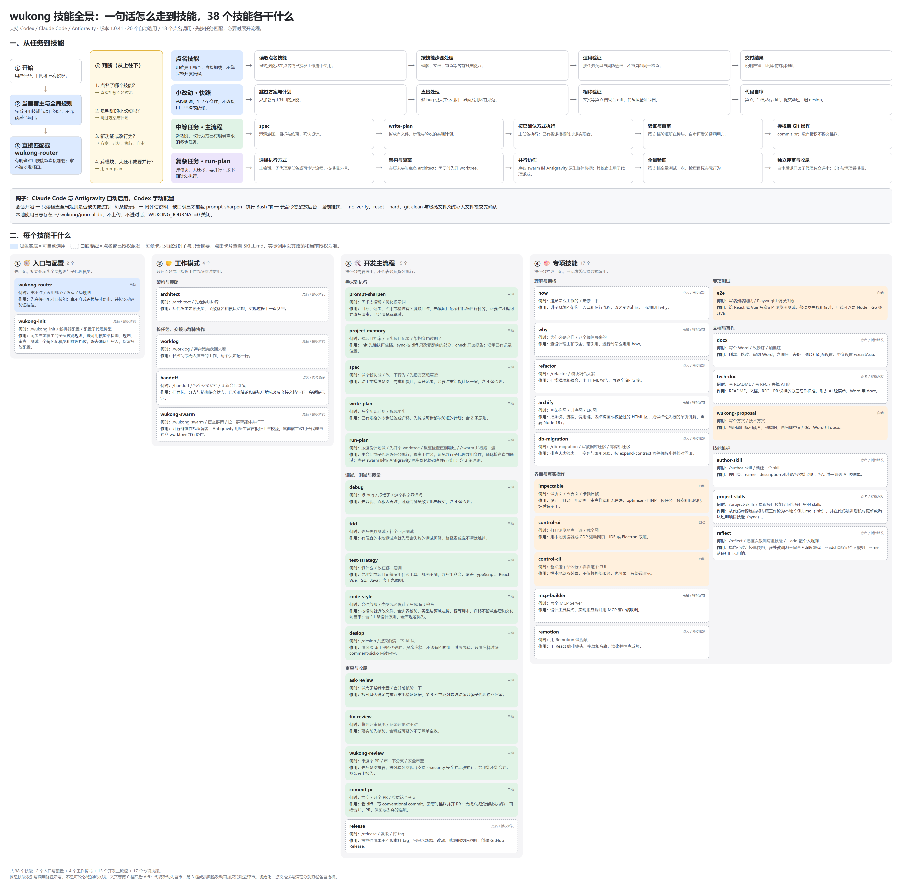

<p align="center">
  
</p>

<h1 align="center">wukong</h1>

<p align="center"><strong>把日常写代码的方式，写成技能。</strong></p>

<p align="center">先定规格、再拆计划、按步实现、审查收尾；排错讲证据，改动按档验证。<br />支持 Codex、Claude Code、Antigravity。</p>

<p align="center">当前版本 1.0.41，共 <strong>38</strong> 个技能：20 个自动选用，18 个点名调用。</p>

<p align="center">
  <a href="#安装">安装</a> ·
  <a href="#初始化">初始化</a> ·
  <a href="#使用">使用</a> ·
  <a href="#技能一览">技能一览</a> ·
  <a href="docs/architecture.md">架构说明</a> ·
  <a href="docs/architecture/wukong-panorama.html">交互全景图</a> ·
  <a href="https://github.com/Acefake/s-skills/releases/latest">发行版</a>
</p>

<p align="center">
  <a href="docs/architecture/wukong-panorama.html">
    
  </a>
</p>

---

## 安装

**Claude Code**

```text
/plugin marketplace add Acefake/s-skills
/plugin install wukong@s-skills
```

**Codex**

```text
codex plugin marketplace add Acefake/s-skills
```

再在应用插件管理里安装 `wukong`。若仅对本项目生效，可在 Windows PowerShell 运行 `powershell -NoProfile -File scripts/install_local_skills.ps1` 将技能链接到 `.agents/skills/`。

**Antigravity（`agy` CLI / App / IDE）**

```sh
agy plugin install https://github.com/Acefake/s-skills/tree/main/plugins/wukong   # 远程安装
agy plugin install ./plugins/wukong                                               # 本地安装
```

启用后自动加载 `rules/AGENTS.md` 与 `hooks.json`。本机开发直接挂载仓库可运行 `powershell -NoProfile -File scripts/bootstrap.ps1`。

> 安装或更新后请开新会话；各宿主入口差异见 [宿主适配](plugins/wukong/HOSTS.md)。

## 初始化

首次安装后点名一次 `wukong-init`（`/wukong:wukong-init`），确认预览后再写入：

- **全局规则**：Codex 写入 `~/.codex/AGENTS.md`，Claude Code 写入 `~/.claude/CLAUDE.md`，Antigravity 随插件自带 `rules/AGENTS.md`（仅把模型块与个人块写入 `~/.gemini/config/AGENTS.md`）。规则正文见 [AGENTS.md](plugins/wukong/AGENTS.md)。
- **四角色子代理模型**：按当前宿主可用模型匹配检索、规划、审查、测试四个角色与推理档位；写代码的子代理默认继承当前会话模型。

Codex 手动注册过钩子时，升级后运行 `python <插件目录>/skills/wukong-init/scripts/codex_hooks.py` 检查并按提示 `--apply` 更新路径。

## 使用

自动技能按描述触发，点名技能需显式调用（支持插件命令的宿主用 `/wukong:技能名`，Codex 在技能选择器里选）：

```text
用 debug 修复这个问题，复现后定位根因并验证。
用 spec 先把新功能需求与设计定下来，再写计划。
用 refactor 扫描这个模块的耦合点并出报告。
```

| 常见场景 | 技能 |
|---|---|
| 修 bug、报错、结果不对 | `debug` |
| 做新功能、改行为 | `spec` → `write-plan` |
| 按计划落地、隔离 worktree、并行 | `run-plan` / `wukong-swarm` |
| 写完合并前独立验收 / 审 PR | `ask-review` / `wukong-review` |
| 处理 PR 评审意见 | `fix-review` |
| 提交、开 PR、分支收尾 | `commit-pr` |
| 做页面、改界面、交互性能 | `impeccable` |
| 写 README、RFC、去 AI 腔 / Word | `tech-doc` / `docx` |
| 写中文项目或技术方案 | `wukong-proposal` |
| 拿不准该用哪个 | `wukong-router` |

T3 Code 下沿用底层宿主技能，编排细节见 [T3 编排参考](plugins/wukong/skills/wukong-router/references/t3-code-tools.md)。

## 验证分档与评审

按改动风险定档，同一份代码已验证则复用、不重跑：

| 档 | 适用范围 | 验证要求 |
|---|---|---|
| 0 | 文案、注释、样式数值、配置值、只读任务、用户说不用测 | 不跑测试，看 diff |
| 1 | 意图明确、1–2 个文件且不改接口/数据结构/依赖的小改动（跳过 `spec`/`write-plan`） | lint 或类型检查 + 已有测试 |
| 2 | 其他修 bug、加功能、改行为 | 有便宜测试点先走 `tdd`，验证所在模块 |
| 3 | 跨模块、改接口或依赖、迁移；非第 0 档提交/合并前 | 全量测试一次 |

- **自审与独立评审**：交付前按 `code-style` 自审（第 0、1 档只看 diff，第 2 档起看关键调用方）；第 3 档或涉及权限、并发、共享状态、数据删除时，再按 `ask-review` 派只读子代理独立评审。
- **权限边界**：提交、推送、改写历史、对外消息和清理工作区均需明确授权，细则见 [wukong-router](plugins/wukong/skills/wukong-router/SKILL.md)。

## 钩子

Claude Code 与 Antigravity 自动启用，只提醒或请求确认，不改写输入（详见 [钩子说明](plugins/wukong/hooks/README.md)，Codex 手动配置见 [Codex 配置](plugins/wukong/skills/prompt-sharpen/references/hook.md)）：

- **会话开始**：只读检查全局规则是否缺失或过期。
- **每条提示词**：缺口明显时提醒加载 `prompt-sharpen`；跳过短确认、`*`/`#`/`/` 开头与 4 字以内消息。
- **执行 Bash / Git 前**：长命令提醒放后台；强推、`--no-verify`、`reset --hard`、`git clean` 及敏感文件/密钥/大文件提交弹窗确认。
- **本地使用日志**：脱敏记录技能使用与纠正到 `~/.wukong/journal.db`（不上传，供 `reflect --me` 归纳个人规则，`WUKONG_JOURNAL=0` 关闭）。

## 技能一览

「点名」技能含 `disable-model-invocation: true`，仅在点名或已授权工作流中运行；历史改名与退役对照见 [RENAMES.md](RENAMES.md)。

### 入口与配置（2）

| 技能 | 调用 | 用途 |
|---|---|---|
| `wukong-router` | 自动 | 拿不准或跨模块时先查路由，同时定验证档位 |
| `wukong-init` | 点名 | 同步全局规则并配置四角色子代理模型与推理档位 |

### 工作模式（4）

| 技能 | 调用 | 用途 |
|---|---|---|
| `architect` | 点名 | 写代码前定类型、签名和模块边界，实现中持续把关 |
| `worklog` | 点名 | 长任务或无人值守运行时逐条记录决策日志 |
| `handoff` | 点名 | 压缩目标、分支状态、已验证结论和踩坑为跨会话交接单 |
| `wukong-swarm` | 点名 | 并行群体协作：Antigravity 用原生留言板，其余宿主用子代理与 worktree |

### 开发主流程（15）

| 技能 | 调用 | 用途 |
|---|---|---|
| `prompt-sharpen` | 自动 | 需求缺口明显时先读项目补背景，必要时提问澄清 |
| `project-memory` | 自动 | 建立并按 diff 增量维护项目架构、规范、决策与术语表 |
| `spec` | 自动 | 动手前摸清意图、权衡方案并输出设计规格（含 4 条原则） |
| `write-plan` | 自动 | 将确认的规格拆成每步可验证的实现计划（含 2 条原则） |
| `run-plan` | 自动 | 按计划执行：主会话/子代理逐任务、worktree 隔离与循环检查（含 3 条原则） |
| `debug` | 自动 | 先复现、追根因、验假设再修 bug（含 4 条原则） |
| `tdd` | 自动 | 有便宜稳定测试点时先写失败测试再实现 |
| `test-strategy` | 自动 | 规划各层测试工具与范围（TS/React、Vue、Go、Java；含 1 条原则） |
| `code-style` | 自动 | 模块布局、边界校验、类型设计与交付前自审（含 11 条原则） |
| `deslop` | 自动 | 提交前清理代码腔、多余防御与注释（注释审查派 `comment-sicko`） |
| `ask-review` | 自动 | 完成后核对需求与验证证据，按风险派只读子代理独立评审 |
| `fix-review` | 自动 | 落实评审意见前先核验，合理则修、存疑举证 |
| `wukong-review` | 自动 | 中文代码审查：审 PR、分支或本地 diff（支持 `--security` 安全专项） |
| `commit-pr` | 自动 | 看 diff 写提交说明、推送开 PR 及分支收尾 |
| `release` | 点名 | 按清单版本打 tag、写发版说明并创建 GitHub Release |

### 专项技能（17）

| 技能 | 调用 | 用途 |
|---|---|---|
| `how` | 点名 | 讲解子系统架构、入口与运行流程 |
| `why` | 点名 | 带引用追查设计理由与历史取舍 |
| `refactor` | 点名 | 扫描浅模块与紧耦合，生成 HTML 对比报告并定案 |
| `archify` | 点名 | 生成经校验的单文件 HTML 架构图、流程图、时序图、ER 图（需 Node 18+） |
| `db-migration` | 点名 | 排查 DDL 锁表与索引风险，按 expand-contract 拆零停机迁移步骤 |
| `impeccable` | 自动 | 界面设计、打磨、审查与 `optimize` 交互性能优化 |
| `control-ui` | 自动 | 驱动真浏览器或桌面 UI 取证 |
| `control-cli` | 自动 | 本地驱动 CLI 或 TUI 验证行为 |
| `mcp-builder` | 点名 | 设计工具契约、实现并联调 MCP 服务 |
| `remotion` | 点名 | 用 React 编排镜头、字幕与音轨并渲染视频 |
| `e2e` | 自动 | 编写稳定的 Playwright/Cypress 端到端测试并治理偶发失败 |
| `docx` | 点名 | 创建、修订、批注与阅读 Word（中文配置 `w:eastAsia`） |
| `tech-doc` | 点名 | README、文档、RFC、PR 说明写作标准与去 AI 腔清单 |
| `wukong-proposal` | 自动 | 写中文项目/技术/活动方案：先问清目标读者、列提纲再成文 |
| `author-skill` | 点名 | 按仓库规范编写或重写 `SKILL.md` |
| `project-skills` | 点名 | 从代码库提取项目高频工作流为本地技能（`init`）并同步淘汰（`sync`） |
| `reflect` | 点名 | 将对话教训沉淀回技能，或用 `--add` / `--me` 管理个人规则 |

> `docx` 需 Python 3.12、Node.js、LibreOffice、poppler、pandoc 与 Noto CJK。

## 维护

技能放在 `plugins/wukong/skills/<英文名>/SKILL.md`，淘汰名称记入 `scripts/marketplace_lib.py` 的 `RETIRED_SKILLS`。校验需 Python 3.10+：

```text
python -m pip install -r requirements-dev.txt
python scripts/update_skill_policies.py
python scripts/bump_plugin_version.py wukong
python scripts/check_marketplace.py
python -m unittest discover -s scripts -p "test_*.py"
claude plugin validate plugins/wukong
git config core.hooksPath scripts/git-hooks
```

- 发版点名 `release`；新增自动技能需在 `scripts/trigger_cases.json` 补触发用例；真实行为评测见 [evals](plugins/wukong/evals/README.md)。

## 许可证

wukong 按 [LICENSE](plugins/wukong/LICENSE) 发布，第三方声明见 [docs/third-party-licenses.md](docs/third-party-licenses.md)。
