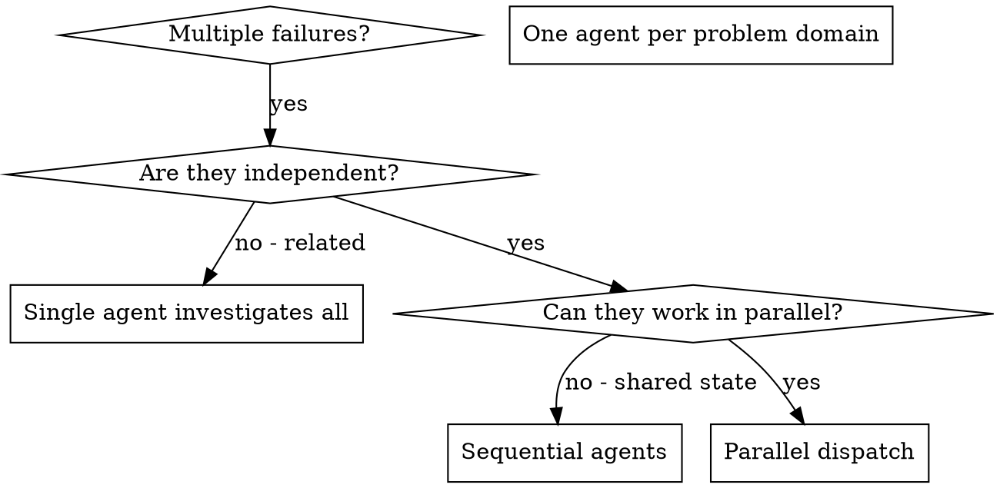

## 运行环境适配

在 Codex 或 T3 Code 中，执行前先阅读[宿主适配规则](../../plugins/s/HOSTS.md)；其中的模型、委派、浏览器和定时任务规则优先于下文的 Cursor 专用示例。

本技能译自 Jesse Vincent 的 Superpowers（MIT）。许可证见上一级文件夹的 `LICENSE-superpowers`。

# 调度并行代理

## 概述

你把任务委托给上下文彼此隔离的专门代理。通过精确编写它们的指令和上下文，你确保它们保持专注并完成任务。它们绝不应该继承你这次会话的上下文或历史——你只构造它们恰好需要的东西。这也把你自己的上下文留给协调工作。

当你有多个互不相关的失败（不同的测试文件、不同的子系统、不同的缺陷）时，逐个调查是在浪费时间。每次调查都是独立的，可以并行进行。

**核心原则：** 每个独立问题域派一个代理。让它们同时工作。

## 何时使用



**在这些时候使用：**
- 3 个以上测试文件因不同根因失败
- 多个子系统各自独立地坏了
- 每个问题都可以不借助其他问题的上下文来理解
- 各次调查之间没有共享状态

**在这些时候不要使用：**
- 失败是相关的（修好一个可能修好其他）
- 需要理解整个系统状态
- 代理会互相干扰

## 模式

### 1. 识别独立领域

按「坏的是什么」把失败分组：
- 文件 A 的测试：工具审批流程
- 文件 B 的测试：批量完成行为
- 文件 C 的测试：中止功能

每个领域都是独立的——修好工具审批不会影响中止测试。

### 2. 创建聚焦的代理任务

每个代理得到：
- **具体范围：** 一个测试文件或一个子系统
- **明确目标：** 让这些测试通过
- **约束：** 不要改其他代码
- **期望输出：** 你发现了什么、修好了什么的摘要

### 3. 并行调度

在同一次响应里发出全部三个子代理调度——它们会并行运行：

```text
Subagent (general-purpose): "Fix agent-tool-abort.test.ts failures"
Subagent (general-purpose): "Fix batch-completion-behavior.test.ts failures"
Subagent (general-purpose): "Fix tool-approval-race-conditions.test.ts failures"
# All three run concurrently.
```

一次响应里多次调度调用 = 并行执行。每次响应只调度一个 = 顺序执行。

### 4. 审查并集成

代理返回后：
- 阅读每份摘要
- 核实修复彼此不冲突
- 跑完整测试套件
- 集成全部改动

## 代理提示词结构

好的代理提示词是：
1. **聚焦的**——一个清楚的问题域
2. **自包含的**——理解问题所需的全部上下文
3. **对输出有具体要求**——代理应该返回什么？

```markdown
Fix the 3 failing tests in src/agents/agent-tool-abort.test.ts:

1. "should abort tool with partial output capture" - expects 'interrupted at' in message
2. "should handle mixed completed and aborted tools" - fast tool aborted instead of completed
3. "should properly track pendingToolCount" - expects 3 results but gets 0

These are timing/race condition issues. Your task:

1. Read the test file and understand what each test verifies
2. Identify root cause - timing issues or actual bugs?
3. Fix by:
   - Replacing arbitrary timeouts with event-based waiting
   - Fixing bugs in abort implementation if found
   - Adjusting test expectations if testing changed behavior

Do NOT just increase timeouts - find the real issue.

Return: Summary of what you found and what you fixed.
```

## 常见错误

**❌ 太宽：**「修好所有测试」——代理会迷路
**✅ 具体：**「修好 agent-tool-abort.test.ts」——范围聚焦

**❌ 没有上下文：**「修好这个竞态条件」——代理不知道在哪
**✅ 有上下文：** 贴上错误信息和测试名称

**❌ 没有约束：** 代理可能会重构一切
**✅ 有约束：**「不要改生产代码」或「只修测试」

**❌ 输出含糊：**「修好它」——你不知道改了什么
**✅ 具体：**「返回根因和改动的摘要」

## 何时不要使用

**相关的失败：** 修好一个可能修好其他——先放在一起调查
**需要完整上下文：** 理解问题必须看到整个系统
**探索性调试：** 你还不知道坏的是什么
**共享状态：** 代理会互相干扰（编辑同一批文件、使用同一批资源）

## 来自一次会话的真实例子

**情景：** 一次大重构之后，3 个文件里有 6 个测试失败

**失败：**
- agent-tool-abort.test.ts：3 个失败（时序问题）
- batch-completion-behavior.test.ts：2 个失败（工具没有执行）
- tool-approval-race-conditions.test.ts：1 个失败（执行次数 = 0）

**决定：** 领域独立——中止逻辑、批量完成、竞态条件彼此分开

**调度：**
```
Agent 1 → Fix agent-tool-abort.test.ts
Agent 2 → Fix batch-completion-behavior.test.ts
Agent 3 → Fix tool-approval-race-conditions.test.ts
```

**结果：**
- 代理 1：用基于事件的等待替换了超时
- 代理 2：修好了事件结构缺陷（threadId 放错了位置）
- 代理 3：加上了等待，让异步工具执行完成

**集成：** 所有修复彼此独立，没有冲突，完整套件变绿

**省下的时间：** 3 个问题并行解决，而不是顺序解决

## 主要好处

1. **并行化**——多次调查同时进行
2. **聚焦**——每个代理范围窄，要跟踪的上下文更少
3. **独立**——代理彼此不干扰
4. **速度**——3 个问题用 1 个问题的时间解决

## 验证

代理返回后：
1. **审查每份摘要**——弄清改了什么
2. **检查冲突**——代理是否编辑了同一处代码？
3. **跑完整套件**——核实所有修复能一起工作
4. **抽查**——代理可能犯系统性错误

## 实际影响

来自一次调试会话（2025-10-03）：
- 3 个文件里 6 个失败
- 并行派出 3 个代理
- 所有调查同时完成
- 所有修复成功集成
- 代理改动之间零冲突
