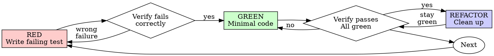

## 运行环境适配

在 Codex 或 T3 Code 中，执行前先阅读[宿主适配规则](../../plugins/s/HOSTS.md)；其中的模型、委派、浏览器和定时任务规则优先于下文的 Cursor 专用示例。

本技能译自 Jesse Vincent 的 Superpowers（MIT）。许可证见上一级文件夹的 `LICENSE-superpowers`。

# 测试驱动开发（TDD）

## 概述

先写测试。看着它失败。再写刚好能通过的最少代码。

**核心原则：** 如果你没有亲眼看到测试失败，你就不知道它测的是不是该测的东西。

**违反规则的字面，就是违反规则的精神。**

## 何时使用

**始终使用：**
- 新功能
- 缺陷修复
- 重构
- 行为变更

**例外（先问你的人类搭档）：**
- 一次性原型
- 生成的代码
- 配置文件

想着「就这一次跳过 TDD」？停。那是在给自己找合理化借口。

## 铁律

```
NO PRODUCTION CODE WITHOUT A FAILING TEST FIRST
```

先写了代码再补测试？删掉。从头来。

**没有例外：**
- 不要把它留作「参考」
- 不要边写测试边「改一改」它
- 不要看它
- 删除就是删除

从测试出发重新实现。就这样。

## 红-绿-重构



### RED - 编写失败测试

写一个最小测试，表明应该发生什么。

<Good>
```typescript
test('retries failed operations 3 times', async () => {
  let attempts = 0;
  const operation = () => {
    attempts++;
    if (attempts < 3) throw new Error('fail');
    return 'success';
  };

  const result = await retryOperation(operation);

  expect(result).toBe('success');
  expect(attempts).toBe(3);
});
```
名称清楚，测的是真实行为，只测一件事
</Good>

<Bad>
```typescript
test('retry works', async () => {
  const mock = jest.fn()
    .mockRejectedValueOnce(new Error())
    .mockRejectedValueOnce(new Error())
    .mockResolvedValueOnce('success');
  await retryOperation(mock);
  expect(mock).toHaveBeenCalledTimes(3);
});
```
名称含糊，测的是 mock 而不是代码
</Bad>

**要求：**
- 只测一种行为
- 名称清楚
- 用真实代码（除非无法避免，否则不要 mock）

### 验证 RED - 看着它失败

**必须做。绝不能跳过。**

```bash
npm test path/to/test.test.ts
```

确认：
- 测试失败（而不是报错）
- 失败信息符合预期
- 失败是因为功能还不存在（而不是拼写错误）

**测试通过了？** 你在测已有行为。改测试。

**测试报错？** 修好错误，重跑，直到它以正确方式失败。

### GREEN - 最少代码

写能让测试通过的最简单代码。

<Good>
```typescript
async function retryOperation<T>(fn: () => Promise<T>): Promise<T> {
  for (let i = 0; i < 3; i++) {
    try {
      return await fn();
    } catch (e) {
      if (i === 2) throw e;
    }
  }
  throw new Error('unreachable');
}
```
刚好够通过
</Good>

<Bad>
```typescript
async function retryOperation<T>(
  fn: () => Promise<T>,
  options?: {
    maxRetries?: number;
    backoff?: 'linear' | 'exponential';
    onRetry?: (attempt: number) => void;
  }
): Promise<T> {
  // YAGNI
}
```
过度设计
</Bad>

不要加功能，不要重构其他代码，也不要做测试没要求的「改进」。

### 验证 GREEN - 看着它通过

**必须做。**

```bash
npm test path/to/test.test.ts
```

确认：
- 测试通过
- 其他测试仍然通过
- 输出干净（没有错误、没有警告）

**测试失败？** 改代码，不要改测试。

**其他测试失败？** 立刻修。

### REFACTOR - 清理

只有在变绿之后：
- 去掉重复
- 改进命名
- 抽出辅助函数

保持测试为绿。不要增加行为。

### 重复

为下一个功能写下一个失败测试。

## 好的测试

| 品质 | 好 | 坏 |
|---------|------|-----|
| **最小** | 只测一件事。名称里有「和」？拆开。 | `test('validates email and domain and whitespace')` |
| **清楚** | 名称描述行为 | `test('test1')` |
| **体现意图** | 展示期望的 API | 把代码该做什么弄得含糊不清 |

## 为什么顺序重要

**「我写完再补测试，用来验证它能工作」**

后补的测试会立刻通过。立刻通过什么也证明不了：
- 可能测错了东西
- 可能测的是实现，不是行为
- 可能漏掉你忘了的边界情况
- 你从未看到它抓住这个缺陷

先写测试迫使你看到测试失败，从而证明它确实在测某件事。

**「我已经手动测过所有边界情况」**

手动测试是随手做的。你以为都测了，但：
- 没有记录测过什么
- 代码一变就不能重跑
- 压力之下容易漏掉情况
- 「我试的时候是好的」≠ 覆盖全面

自动化测试是系统化的。每次都以同样方式运行。

**「删掉已经花了 X 小时的工作太浪费」**

沉没成本谬误。时间已经花掉了。你现在的选择是：
- 删掉，用 TDD 重写（再花 X 小时，信心高）
- 留下，事后补测试（30 分钟，信心低，很可能有缺陷）

真正的「浪费」是留下你无法信任的代码。能跑但没有真正测试的代码是技术债。

**「TDD 太教条，务实就是要变通」**

TDD 本身就是务实的：
- 在提交前发现缺陷（比事后调试更快）
- 防止回归（测试立刻抓住破坏）
- 记录行为（测试展示代码怎么用）
- 让重构成为可能（放心改，测试会抓住破坏）

「务实」的捷径 = 在生产环境里调试 = 更慢。

**「事后补测试能达到同样目的——重要的是精神不是仪式」**

不能。事后测试回答的是「这做了什么？」先写测试回答的是「这应该做什么？」

事后测试会被你的实现带偏。你测的是你建出来的东西，不是被要求的东西。你验证的是记得住的边界情况，不是被发现的边界情况。

先写测试迫使你在实现之前发现边界情况。事后测试只是验证你全都记得（你并没有）。

事后补 30 分钟测试 ≠ TDD。你得到覆盖率，失去「测试真的有效」的证明。

## 常见合理化借口

| 借口 | 事实 |
|--------|---------|
| 「太简单，不用测」 | 简单代码也会坏。测试只要 30 秒。 |
| 「我之后再测」 | 立刻通过的测试什么也证明不了。 |
| 「事后测试能达到同样目的」 | 事后测试 =「这做了什么？」先写测试 =「这应该做什么？」 |
| 「已经手动测过了」 | 随手测 ≠ 系统化。没有记录，不能重跑。 |
| 「删掉 X 小时太浪费」 | 沉没成本谬误。留下未经验证的代码就是技术债。 |
| 「留作参考，先写测试」 | 你会去改它。那就是事后测试。删除就是删除。 |
| 「需要先探索」 | 可以。把探索扔掉，再用 TDD 开始。 |
| 「测试很难 = 设计不清楚」 | 听测试的。难测就是难用。 |
| 「TDD 会拖慢我」 | TDD 比调试快。务实 = 先写测试。 |
| 「手动测试更快」 | 手动测试证明不了边界情况。每次改动你都得重测。 |
| 「现有代码没有测试」 | 你正在改进它。给现有代码补测试。 |

## 危险信号 - 停下并从头来

- 先写代码后写测试
- 实现之后才写测试
- 测试立刻通过
- 说不清测试为什么失败
- 测试「以后再加」
- 用「就这一次」给自己开脱
- 「我已经手动测过了」
- 「事后测试能达到同样目的」
- 「重要的是精神不是仪式」
- 「留作参考」或「改现有代码」
- 「已经花了 X 小时，删掉太浪费」
- 「TDD 太教条，我这是务实」
- 「这次不一样，因为……」

**这些全都意味着：删掉代码。用 TDD 从头来。**

## 示例：缺陷修复

**缺陷：** 空邮箱被接受

**RED**
```typescript
test('rejects empty email', async () => {
  const result = await submitForm({ email: '' });
  expect(result.error).toBe('Email required');
});
```

**验证 RED**
```bash
$ npm test
FAIL: expected 'Email required', got undefined
```

**GREEN**
```typescript
function submitForm(data: FormData) {
  if (!data.email?.trim()) {
    return { error: 'Email required' };
  }
  // ...
}
```

**验证 GREEN**
```bash
$ npm test
PASS
```

**REFACTOR**
如果需要，把校验抽出来给多个字段用。

## 验证检查清单

把工作标为完成之前：

- [ ] 每个新函数/方法都有测试
- [ ] 实现之前亲眼看到每个测试失败
- [ ] 每个测试都因预期原因失败（功能缺失，不是拼写错误）
- [ ] 为每个测试写了最少代码使其通过
- [ ] 全部测试通过
- [ ] 输出干净（没有错误、没有警告）
- [ ] 测试使用真实代码（只有无法避免时才 mock）
- [ ] 覆盖了边界情况和错误

没法全部勾上？你跳过了 TDD。从头来。

## 卡住时

| 问题 | 办法 |
|---------|----------|
| 不知道怎么测 | 写下你希望有的 API。先写断言。问你的人类搭档。 |
| 测试太复杂 | 设计太复杂。简化接口。 |
| 必须 mock 一切 | 代码耦合太紧。使用依赖注入。 |
| 测试准备太庞大 | 抽出辅助函数。仍然复杂？简化设计。 |

## 与调试结合

发现缺陷？写一个能复现它的失败测试。走 TDD 循环。测试既证明修复有效，也防止回归。

绝不要在没有测试的情况下修缺陷。

## 测试反模式

添加 mock 或测试工具时，阅读 [testing-anti-patterns.md](testing-anti-patterns.md)，避开常见陷阱：
- 测的是 mock 行为而不是真实行为
- 往生产类里加只给测试用的方法
- 不理解依赖就做 mock

## 最终规则

```
Production code → test exists and failed first
Otherwise → not TDD
```

没有你的人类搭档许可，就没有例外。
