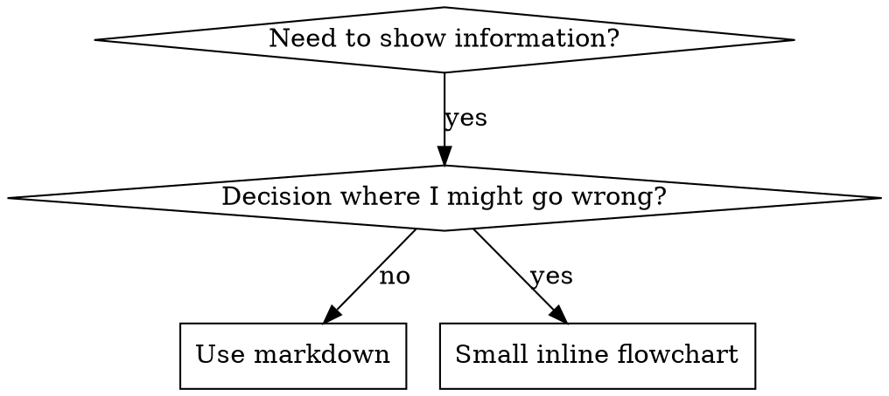

## 运行环境适配

在 Codex 或 T3 Code 中，执行前先阅读[宿主适配规则](../../plugins/s/HOSTS.md)；其中的模型、委派、浏览器和定时任务规则优先于下文的 Cursor 专用示例。

本技能译自 Jesse Vincent 的 Superpowers（MIT）。许可证见上一级文件夹的 `LICENSE-superpowers`。

# 编写技能

## 概述

**编写技能，就是把测试驱动开发用在流程文档上。**

**个人技能放在你的运行时的技能目录里**

你编写测试用例（带子代理的压力情景），看着它们失败（基线行为），编写技能（文档），看着测试通过（代理遵从），然后重构（堵住漏洞）。

**核心原则：** 如果你没有看着代理在没有该技能时失败，你就不知道这个技能教的是不是该教的东西。

**必备背景：** 使用本技能之前，你必须理解 superpowers:test-driven-development。那个技能定义了基本的 RED-GREEN-REFACTOR 循环。本技能把 TDD 改造用于文档。

**官方指导：** Anthropic 官方的技能编写最佳实践见 anthropic-best-practices.md。那份文档提供了额外的模式和准则，用来补充本技能里以 TDD 为中心的做法。

## 什么是技能？

**技能**是一份参考指南，讲的是经过验证的技巧、模式或工具。技能帮助未来的代理找到并应用有效做法。

**技能是：** 可复用的技巧、模式、工具、参考指南

**技能不是：** 关于你某一次如何解决某个问题的叙述

## 技能的 TDD 对照

| TDD 概念 | 技能创建 |
|-------------|----------------|
| **测试用例** | 带子代理的压力情景 |
| **生产代码** | 技能文档（SKILL.md） |
| **测试失败（RED）** | 没有技能时代理违反规则（基线） |
| **测试通过（GREEN）** | 有技能时代理遵从 |
| **重构** | 在保持遵从的同时堵住漏洞 |
| **先写测试** | 在编写技能之前先跑基线情景 |
| **看着它失败** | 逐字记录代理使用的合理化借口 |
| **最少代码** | 写出针对那些具体违规的技能 |
| **看着它通过** | 核实代理现在遵从 |
| **重构循环** | 发现新的合理化借口 → 堵上 → 再验证 |

整个技能创建过程遵循 RED-GREEN-REFACTOR。

## 何时创建技能

**在这些时候创建：**
- 那套技巧对你来说并不是直觉上就显而易见的
- 你会在多个项目里再次参考它
- 模式适用面广（不是某个项目专属）
- 别人也会受益

**不要为这些创建：**
- 一次性解决方案
- 别处已经有完善文档的标准实践
- 项目专属约定（放到你的说明文件里）
- 机械约束（如果用正则或校验就能强制执行，就把它自动化——把文档留给需要判断的地方）

## 技能类型

### 技巧
有步骤可遵循的具体方法（condition-based-waiting、root-cause-tracing）

### 模式
思考问题的方式（flatten-with-flags、test-invariants）

### 参考
API 文档、语法指南、工具文档（office 文档）

## 目录结构


```
skills/
  skill-name/
    SKILL.md              # Main reference (required)
    supporting-file.*     # Only if needed
```

**扁平命名空间**——所有技能都在一个可搜索的命名空间里

**以下内容单独成文件：**
1. **大块参考**（100 行以上）——API 文档、全面的语法
2. **可复用工具**——脚本、实用程序、模板

**留在正文里：**
- 原则和概念
- 代码模式（少于 50 行）
- 其他一切

## SKILL.md 结构

**Frontmatter（YAML）：**
- 两个必填字段：`name` 和 `description`（全部受支持字段见 [agentskills.io/specification](https://agentskills.io/specification)）
- 总共最多 1024 个字符
- `name`：只用字母、数字和连字符（不要括号、不要特殊字符）
- `description`：第三人称，只描述何时使用（不要描述它做什么）
  - 以 "Use when..." 开头，把焦点放在触发条件上
  - 包含具体症状、情境和上下文
  - **绝不要概括技能的过程或工作流**（原因见 SDO 一节）
  - 可能的话保持在 500 个字符以内

```markdown
---
name: Skill-Name-With-Hyphens
description: Use when [specific triggering conditions and symptoms]
---

# Skill Name

## Overview
What is this? Core principle in 1-2 sentences.

## When to Use
[Small inline flowchart IF decision non-obvious]

Bullet list with SYMPTOMS and use cases
When NOT to use

## Core Pattern (for techniques/patterns)
Before/after code comparison

## Quick Reference
Table or bullets for scanning common operations

## Implementation
Inline code for simple patterns
Link to file for heavy reference or reusable tools

## Common Mistakes
What goes wrong + fixes

## Real-World Impact (optional)
Concrete results
```


## 技能发现优化（SDO）

**对发现至关重要：** 未来的代理需要找到你的技能

### 1. 丰富的 description 字段

**目的：** 你的代理阅读 description，决定为给定任务加载哪些技能。让它回答：「我现在应该读这个技能吗？」

**格式：** 以 "Use when..." 开头，把焦点放在触发条件上

**关键：description = 何时使用，不是技能做什么**

description 应该只描述触发条件。不要在 description 里概括技能的过程或工作流。

**为什么这重要：** 测试表明，当 description 概括了技能的工作流时，代理可能跟着 description 走，而不去读完整的技能内容。一条写着「任务之间做代码审查」的 description，让代理只做了一次审查，尽管技能的流程图清楚地显示有两次审查（先是规格符合性，然后是代码质量）。

当 description 改成仅仅是 "Use when executing implementation plans with independent tasks"（没有工作流概括）时，代理正确地读了流程图，并遵循了两阶段审查过程。

**陷阱：** 概括工作流的 description 制造了一条代理会走的捷径。技能正文变成代理会跳过的文档。

```yaml
# ❌ BAD: Summarizes workflow - agents may follow this instead of reading skill
description: Use when executing plans - dispatches subagent per task with code review between tasks

# ❌ BAD: Too much process detail
description: Use for TDD - write test first, watch it fail, write minimal code, refactor

# ✅ GOOD: Just triggering conditions, no workflow summary
description: Use when executing implementation plans with independent tasks in the current session

# ✅ GOOD: Triggering conditions only
description: Use when implementing any feature or bugfix, before writing implementation code
```

**内容：**
- 使用表明本技能适用的具体触发、症状和情境
- 描述*问题*（竞态条件、行为不一致），不要描述*特定语言的症状*（setTimeout、sleep）
- 除非技能本身是针对某项技术的，否则触发条件保持技术无关
- 如果技能是针对某项技术的，在触发条件里明确写出来
- 用第三人称写（会被注入系统提示）
- **绝不要概括技能的过程或工作流**

```yaml
# ❌ BAD: Too abstract, vague, doesn't include when to use
description: For async testing

# ❌ BAD: First person
description: I can help you with async tests when they're flaky

# ❌ BAD: Mentions technology but skill isn't specific to it
description: Use when tests use setTimeout/sleep and are flaky

# ✅ GOOD: Starts with "Use when", describes problem, no workflow
description: Use when tests have race conditions, timing dependencies, or pass/fail inconsistently

# ✅ GOOD: Technology-specific skill with explicit trigger
description: Use when using React Router and handling authentication redirects
```

### 2. 关键词覆盖

使用代理会搜索的词：
- 错误信息："Hook timed out"、"ENOTEMPTY"、"race condition"
- 症状："flaky"、"hanging"、"zombie"、"pollution"
- 同义词："timeout/hang/freeze"、"cleanup/teardown/afterEach"
- 工具：实际命令、库名、文件类型

### 3. 有描述性的命名

**用主动语态，动词开头：**
- ✅ `creating-skills`，不要 `skill-creation`
- ✅ `condition-based-waiting`，不要 `async-test-helpers`

### 4. Token 效率（关键）

**问题：** getting-started 和被频繁引用的技能会加载进每一次对话。每个 token 都要计较。

**目标词数：**
- getting-started 工作流：每个少于 150 词
- 频繁加载的技能：总共少于 200 词
- 其他技能：少于 500 词（仍然要简洁）

**技巧：**

**把细节移到工具的帮助里：**
```bash
# ❌ BAD: Document all flags in SKILL.md
search-conversations supports --text, --both, --after DATE, --before DATE, --limit N

# ✅ GOOD: Reference --help
search-conversations supports multiple modes and filters. Run --help for details.
```

**使用交叉引用：**
```markdown
# ❌ BAD: Repeat workflow details
When searching, dispatch subagent with template...
[20 lines of repeated instructions]

# ✅ GOOD: Reference other skill
Always use subagents (50-100x context savings). REQUIRED: Use [other-skill-name] for workflow.
```

**压缩示例：**
```markdown
# ❌ BAD: Verbose example (42 words)
your human partner: "How did we handle authentication errors in React Router before?"
You: I'll search past conversations for React Router authentication patterns.
[Dispatch subagent with search query: "React Router authentication error handling 401"]

# ✅ GOOD: Minimal example (20 words)
Partner: "How did we handle auth errors in React Router?"
You: Searching...
[Dispatch subagent → synthesis]
```

**消除冗余：**
- 不要重复交叉引用的技能里已有的内容
- 不要解释从命令本身就能看明白的东西
- 不要为同一模式放多个示例

**验证：**
```bash
wc -w skills/path/SKILL.md
# getting-started workflows: aim for <150 each
# Other frequently-loaded: aim for <200 total
```

**按你所做的事或核心洞见来命名：**
- ✅ `condition-based-waiting` > `async-test-helpers`
- ✅ `using-skills`，不要 `skill-usage`
- ✅ `flatten-with-flags` > `data-structure-refactoring`
- ✅ `root-cause-tracing` > `debugging-techniques`

**动名词（-ing）很适合过程：**
- `creating-skills`、`testing-skills`、`debugging-with-logs`
- 主动，描述你正在采取的行动

### 5. 交叉引用其他技能

**编写引用其他技能的文档时：**

只用技能名，并带上明确的要求标记：
- ✅ 好：`**REQUIRED SUB-SKILL:** Use superpowers:test-driven-development`
- ✅ 好：`**REQUIRED BACKGROUND:** You MUST understand superpowers:systematic-debugging`
- ❌ 差：`See skills/testing/test-driven-development`（看不出是否必须）
- ❌ 差：`@skills/testing/test-driven-development/SKILL.md`（强制加载，烧掉上下文）

**为什么不用 @ 链接：** `@` 语法会立刻强制加载文件，在你需要它们之前就消耗 20 万以上的上下文。

## 流程图的使用



**只在这些情况下使用流程图：**
- 不明显的决策点
- 你可能会过早停下来的过程循环
- 「何时用 A、何时用 B」的决策

**绝不要在这些情况下使用流程图：**
- 参考材料 → 表格、列表
- 代码示例 → Markdown 代码块
- 线性指令 → 编号列表
- 没有语义的标签（step1、helper2）

本目录中的 `graphviz-conventions.dot` 有 graphviz 样式规则。

**给你的人类搭档看图：** 用本目录中的 `render-graphs.js` 把技能的流程图渲染成 SVG：
```bash
./render-graphs.js ../some-skill           # Each diagram separately
./render-graphs.js ../some-skill --combine # All diagrams in one SVG
```

## 代码示例

**一个出色的示例胜过许多平庸的示例**

选择最相关的语言：
- 测试技巧 → TypeScript/JavaScript
- 系统调试 → Shell/Python
- 数据处理 → Python

**好的示例：**
- 完整且能运行
- 注释得好，解释为什么
- 来自真实情景
- 把模式展示清楚
- 可以直接改来用（不是泛泛的模板）

**不要：**
- 用 5 种以上语言实现
- 做填空模板
- 写牵强的示例

你擅长移植——一个出色的示例就够了。

## 文件组织

### 自包含技能
```
defense-in-depth/
  SKILL.md    # Everything inline
```
何时：全部内容都放得下，不需要大块参考

### 带可复用工具的技能
```
condition-based-waiting/
  SKILL.md    # Overview + patterns
  example.ts  # Working helpers to adapt
```
何时：工具是可复用代码，不只是叙述

### 带大块参考的技能
```
pptx/
  SKILL.md       # Overview + workflows
  pptxgenjs.md   # 600 lines API reference
  ooxml.md       # 500 lines XML structure
  scripts/       # Executable tools
```
何时：参考材料太大，不适合放进正文

## 铁律（与 TDD 相同）

```
NO SKILL WITHOUT A FAILING TEST FIRST
```

这适用于新技能，也适用于对已有技能的编辑。

先写技能再测试？删掉。从头来。
不测试就编辑技能？同样的违规。

**没有例外：**
- 「简单的补充」也不例外
- 「只是加一节」也不例外
- 「文档更新」也不例外
- 不要把未测试的改动留作「参考」
- 不要边跑测试边「改一改」
- 删除就是删除

**必备背景：** superpowers:test-driven-development 技能解释了为什么这重要。同样的原则适用于文档。

## 测试所有类型的技能

不同类型的技能需要不同的测试方法：

### 强制纪律的技能（规则/要求）

**示例：** TDD、verification-before-completion、designing-before-coding

**这样测试：**
- 学院式问题：它们理解规则吗？
- 压力情景：压力下它们遵从吗？
- 多重压力叠加：时间 + 沉没成本 + 疲惫
- 识别合理化借口，并加上明确反制

**成功标准：** 代理在最大压力下遵守规则

### 技巧技能（操作指南）

**示例：** condition-based-waiting、root-cause-tracing、defensive-programming

**这样测试：**
- 应用情景：它们能正确应用这套技巧吗？
- 变体情景：它们能处理边界情况吗？
- 缺失信息测试：指令有缺口吗？

**成功标准：** 代理能把技巧成功应用到新情景

### 模式技能（心智模型）

**示例：** reducing-complexity、信息隐藏概念

**这样测试：**
- 识别情景：它们认得出模式何时适用吗？
- 应用情景：它们能使用这个心智模型吗？
- 反例：它们知道何时不要应用吗？

**成功标准：** 代理能正确判断何时、如何应用模式

### 参考技能（文档/API）

**示例：** API 文档、命令参考、库指南

**这样测试：**
- 检索情景：它们能找到正确信息吗？
- 应用情景：它们能正确使用找到的东西吗？
- 缺口测试：常见用例都覆盖了吗？

**成功标准：** 代理能找到并正确应用参考信息

## 跳过测试的常见合理化借口

| 借口 | 事实 |
|--------|---------|
| 「技能显然很清楚」 | 对你清楚 ≠ 对其他代理清楚。测试它。 |
| 「它只是一份参考」 | 参考也会有缺口、有不清楚的章节。测试检索。 |
| 「测试是多余的」 | 未测试的技能总会有问题。永远如此。15 分钟测试省下数小时。 |
| 「出了问题我再测」 | 问题 = 代理无法使用技能。在部署之前测试。 |
| 「测试太烦了」 | 测试比在生产中调试一个坏技能更不烦。 |
| 「我有信心它很好」 | 过度自信保证会出问题。还是要测。 |
| 「学院式审阅就够了」 | 阅读 ≠ 使用。测试应用情景。 |
| 「没时间测试」 | 部署未测试的技能，以后修它会浪费更多时间。 |

**这些全都意味着：部署前先测试。没有例外。**

## 让形式匹配失败

写指导之前，先给基线失败分类。能让一种失败无懈可击的形式，用在另一种失败上会明显适得其反。

| 基线失败 | 正确形式 | 错误形式 |
|---|---|---|
| 在压力下跳过/违反一条自己其实知道的规则（知道该怎么做，偏偏还是那么做） | 禁止 + 合理化借口表 + 危险信号（见下面的「打磨到无懈可击」） | 软指导（「优先……」、「考虑……」） |
| 遵从了，但输出形状是错的（提示词臃肿、结论被埋没、复述了规格） | 正向配方或契约：写明输出是什么——它的组成部分，按顺序 | 禁止清单（「不要复述」、「绝不叙述」） |
| 从他们已经在产出的东西里漏掉一个必需元素 | 结构性的：他们要填写的模板里有必填字段或槽位 | 模板旁边的散文提醒 |
| 行为应该取决于一个条件 | 以可观察谓词为键的条件（「如果简报存在，就引用它」） | 无条件规则 + 豁免条款 |

**为什么禁止用在「塑造形状」的问题上会适得其反：** 在一个竞争性激励下（「让提示词自包含」），代理会跟「不要 X」讨价还价。在调度提示词指导的对照措辞测试中，禁止组产出的不想要内容明显多于配方组（分布完全分开），甚至趋势上比没有指导的对照组更差——用微测试检验你自己的情况，不要想当然，但绝不要默认就伸手去拿禁止。配方没有什么可谈判的：输出要么符合写明的形状，要么不符合。

**无论你选哪种形式，规则是：**
- **不要加细微差别条款。** 「不要 X，除非它重要」会重新打开谈判——在同样的措辞测试里，给一条获胜配方追加一条细微差别条款，会让它从稳定变成嘈杂。真正的例外要表达成它自己的条件，键是一个可观察谓词。
- **豁免条款框不住范围。** 「这个限制不适用于代码块」仍然会抑制代码块。如果输出的某一部分必须豁免，就重新组织，让规则够不着它。

## 把技能打磨到能抵抗合理化

强制纪律的技能（比如 TDD）需要抵抗合理化。代理很聪明，压力下会找到漏洞。

**范围：** 这套工具针对的是纪律失败——代理知道规则，却在压力下跳过它。对于形状错误的输出或被漏掉的元素，基于禁止的打磨会适得其反；改用「让形式匹配失败」里的形式。

**心理学说明：** 理解说服技巧为什么有效，有助于你系统地应用它们。权威、承诺、稀缺、社会证明和团结原则的研究基础见 persuasion-principles.md（Cialdini, 2021；Meincke 等人, 2025）。

### 明确堵上每一个漏洞

不要只陈述规则——禁止具体的变通：

<Bad>
```markdown
Write code before test? Delete it.
```
</Bad>

<Good>
```markdown
Write code before test? Delete it. Start over.

**No exceptions:**
- Don't keep it as "reference"
- Don't "adapt" it while writing tests
- Don't look at it
- Delete means delete
```
</Good>

### 应对「精神对字面」的争辩

尽早加上基础原则：

```markdown
**Violating the letter of the rules is violating the spirit of the rules.**
```

这切断了整类「我遵循的是精神」的合理化借口。

### 建立合理化借口表

从基线测试中捕获合理化借口（见下面的测试一节）。代理找的每一个借口都放进表里：

```markdown
| Excuse | Reality |
|--------|---------|
| "Too simple to test" | Simple code breaks. Test takes 30 seconds. |
| "I'll test after" | Tests passing immediately prove nothing. |
| "Tests after achieve same goals" | Tests-after = "what does this do?" Tests-first = "what should this do?" |
```

### 建立危险信号列表

让代理在合理化时容易自我检查：

```markdown
## Red Flags - STOP and Start Over

- Code before test
- "I already manually tested it"
- "Tests after achieve the same purpose"
- "It's about spirit not ritual"
- "This is different because..."

**All of these mean: Delete code. Start over with TDD.**
```

### 为违规症状更新 SDO

在 description 里加上：你即将违反规则时的症状：

```yaml
description: use when implementing any feature or bugfix, before writing implementation code
```

## 技能的 RED-GREEN-REFACTOR

遵循 TDD 循环：

### RED：编写失败测试（基线）

在没有该技能的情况下，用子代理跑压力情景。逐字记录确切行为：
- 他们做了什么选择？
- 他们用了什么合理化借口（逐字）？
- 哪些压力触发了违规？

这就是「看着测试失败」——在编写技能之前，你必须看到代理自然会做什么。

### GREEN：编写最小技能

写出针对那些具体合理化借口的技能。不要为假设的情况加额外内容。

在有技能的情况下跑同样的情景。代理现在应该遵从。

### REFACTOR：堵住漏洞

代理找到了新的合理化借口？加上明确反制。重测，直到无懈可击。

### 在完整情景之前先微测试措辞

完整的压力情景运行是最终门禁，但每一轮都慢、都贵。先用微测试核实措辞本身：

1. **每次调用一个全新上下文样本**——一次原始 API 调用，或者如果你没有 API 访问，就用一次性子代理。系统提示 = 指导将身处的现实上下文（完整技能或提示词模板，不是孤立的那条指导）；用户消息 = 一个会诱发出失败的任务。
2. **始终包含一个没有指导的对照。** 如果对照没有表现出那种失败，就没有什么要修的——停下来，不要去写那条指导。
3. **每个变体 5 次以上重复。** 单次样本会骗人。
4. **人工阅读每一个被标记的匹配。** 你可以用程序打分，但模板回声和被引用的反例会伪装成命中；只靠自动计数会同时夸大失败和成功。
5. **方差是一项指标。** 指导生效时，各次重复会收敛到同一种形状。五次重复出现五种不同理解，说明措辞没有约束力——先收紧形式，再增加字数。

微测试核实的是措辞；对纪律类技能，它们不能代替压力情景。

**测试方法：** 完整的测试方法见 [testing-skills-with-subagents.md](testing-skills-with-subagents.md)：
- 如何编写压力情景
- 压力类型（时间、沉没成本、权威、疲惫）
- 系统地堵洞
- 元测试技巧

## 反模式

### ❌ 叙述性示例
「在 2025-10-03 那次会话里，我们发现空的 projectDir 导致了……」
**为什么差：** 太具体，不可复用

### ❌ 多语言稀释
example-js.js、example-py.py、example-go.go
**为什么差：** 质量平庸，维护负担

### ❌ 流程图里写代码
```dot
step1 [label="import fs"];
step2 [label="read file"];
```
**为什么差：** 不能复制粘贴，难以阅读

### ❌ 泛泛的标签
helper1、helper2、step3、pattern4
**为什么差：** 标签应该有语义

## 停下：在转到下一个技能之前

**写完任何一个技能之后，你必须停下，并完成部署过程。**

**不要：**
- 批量创建多个技能，却不逐个测试
- 当前技能还没验证就转到下一个
- 因为「批量更高效」就跳过测试

**下面的部署检查清单对每一个技能都是必须的。**

部署未测试的技能 = 部署未测试的代码。这违反质量标准。

## 技能创建检查清单（TDD 改编）

**重要：为下面每一个检查项建一条待办。**

**RED 阶段 - 编写失败测试：**
- [ ] 创建压力情景（纪律类技能要 3 种以上压力叠加）
- [ ] 在没有技能的情况下跑情景——逐字记录基线行为
- [ ] 识别合理化借口/失败中的模式

**GREEN 阶段 - 编写最小技能：**
- [ ] 名称只用字母、数字、连字符（不要括号/特殊字符）
- [ ] 带必填 `name` 和 `description` 字段的 YAML frontmatter（最多 1024 个字符；见 [规范](https://agentskills.io/specification)）
- [ ] description 以 "Use when..." 开头，并包含具体触发/症状
- [ ] description 用第三人称
- [ ] 全文有供搜索的关键词（错误、症状、工具）
- [ ] 有清楚的概述和核心原则
- [ ] 应对 RED 中识别出的具体基线失败
- [ ] 指导形式与失败类型匹配（见「让形式匹配失败」）
- [ ] 对塑造行为的指导：措辞已对照「没有指导」的对照组做过微测试（5 次以上重复，每个人工标记的匹配都读过）——纯参考技能不适用
- [ ] 代码在正文里，或者链接到单独文件
- [ ] 一个出色的示例（不是多语言）
- [ ] 在有技能的情况下跑情景——核实代理现在遵从

**REFACTOR 阶段 - 堵住漏洞：**
- [ ] 从测试中识别出新的合理化借口
- [ ] 加上明确反制（如果是纪律类技能）
- [ ] 用所有测试迭代建立合理化借口表
- [ ] 建立危险信号列表
- [ ] 重测直到无懈可击

**质量检查：**
- [ ] 只有决策不明显时才用小流程图
- [ ] 速查表
- [ ] 常见错误一节
- [ ] 没有叙述性讲故事
- [ ] 支持文件只用于工具或大块参考

**部署：**
- [ ] 把技能提交到 git，并推送到你的 fork（如果已配置）
- [ ] 考虑通过 PR 贡献回去（如果适用面广）

## 发现工作流

未来的代理如何找到你的技能：

1. **遇到问题**（「测试不稳定」）
2. **搜索技能**（grep 各 description，浏览分类）
3. **找到技能**（description 匹配）
4. **扫一眼概述**（这相关吗？）
5. **读模式**（速查表）
6. **加载示例**（只在实现时）

**为这条流优化**——把可搜索的词尽早、反复放进去。

## 底线

**创建技能，就是流程文档的 TDD。**

同一条铁律：没有先失败的测试，就没有技能。
同一个循环：RED（基线）→ GREEN（编写技能）→ REFACTOR（堵住漏洞）。
同样的好处：质量更好，意外更少，结果无懈可击。

如果你对代码遵循 TDD，就对技能也遵循它。这是同一套纪律，用在文档上。
