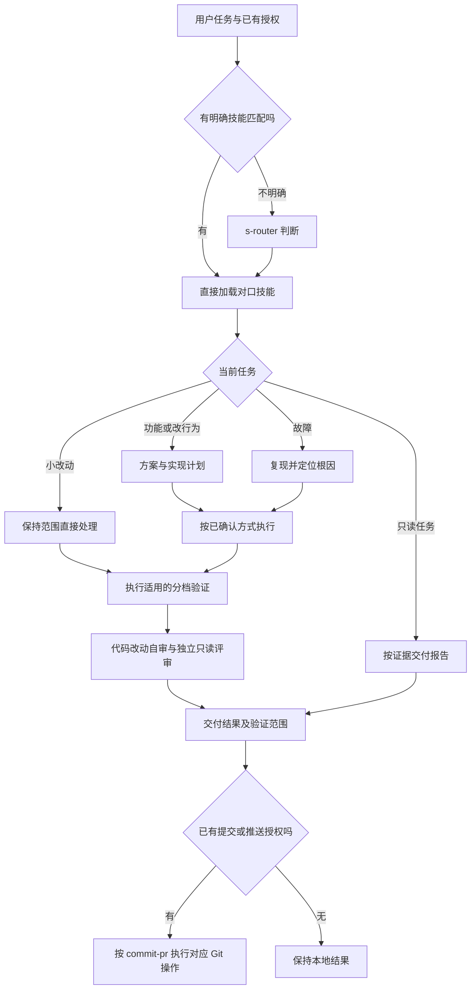
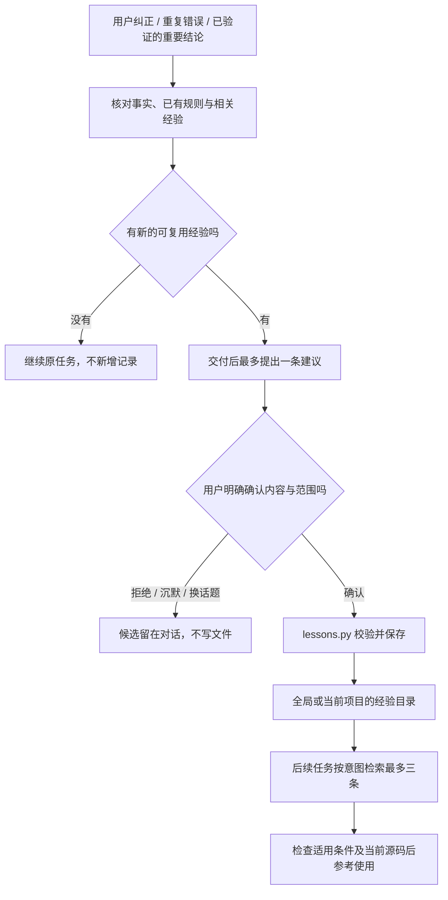

# s-atlas 技能全景：路由、职责与调用边界

s-atlas 是一套由代理读取的技能与本地工具，不是独立运行的 Agent 服务。Codex、Claude Code、Cursor、WorkBuddy 提供会话和执行能力；本仓库提供技能描述、任务流程、宿主适配和确定性的配置、经验读写工具。

当前版本 **1.7.29**，共 **79** 个技能：**58** 个可按描述自动选用，**21** 个保持显式调用。自动选用描述的是调用政策，不保证每轮必然触发。


[全景卡片图源（HTML）](architecture/s-atlas-panorama.html) · [组件关系补充图](architecture/s-atlas.html) · [安装与使用](../README.md)

主图采用白底大画布：上半部分展示点名技能、小改动、普通开发及复杂任务的调用路线，下半部分以五个分栏展示全部技能。每张卡写出“何时”和“作用”；原则卡省略共同的 `principle-` 前缀，实际目录名不变。路线是按需选用的示意，不代表每轮必须执行全部流程。

| 分区 | 卡片数 | 内容 |
|---|---|---|
| 入口与配置 | 4 | 路由、全局提示词、模型配置、经验回读与建议 |
| 工作模式 | 8 | 加强流程、架构决策、协作、长任务与记录 |
| 开发主流程 | 15 | 需求到执行、调试测试、质量、审查与收尾 |
| 专项技能 | 28 | 理解架构、界面操作、专项审查、Office、专利和表达 |
| 做事原则 | 24 | 按具体问题选用的 `principle-*` |

浅色实底为自动技能，白底虚线为显式技能。卡片内容依据 [1f9f9e4](https://github.com/Acefake/s-skills/commit/1f9f9e4170676133c23d11fd43aa6d1b40cd6678) 中的技能描述、正文和调用政策整理，每个技能恰好出现一次，卡片标题链接到对应源码。HTML 是 4500 像素宽的独立可编辑图源，可缩小或横向浏览；PNG 预览可直接放大查看。

组件关系图作为补充保留，表示逻辑职责，不表示分别部署的服务。其 [JSON 图源](architecture/s-atlas.architecture.json) 的节点证据固定在 [dab5ad1](https://github.com/Acefake/s-skills/commit/dab5ad11e14a8b8154b704d0006fc8d9171bd021)，可追溯到具体文件和行号。

## 一、宿主、指令和技能各管一层

| 层次 | 负责什么 | 主要位置 |
|---|---|---|
| 宿主会话 | 提供模型、文件、终端、浏览器和代理能力；能力是否可用以当前会话为准 | Codex、Claude Code、Cursor、WorkBuddy |
| 全局规则 | 指定如何匹配技能、何时验证、如何评审和确认经验 | [AGENTS.md](../plugins/s-atlas/AGENTS.md) |
| 技能发现与路由 | 优先直接匹配；不明确时才由 s-router 判断；不覆盖显式调用政策 | [s-router](../plugins/s-atlas/skills/s-router/SKILL.md) 与各技能 frontmatter |
| 执行流程与能力 | 按任务使用方案、计划、调试、文档、界面、测试等技能 | [skills/](../plugins/s-atlas/skills/) |
| 宿主适配 | 把通用动作映射到当前宿主已有工具，不编造能力 | [HOSTS.md](../plugins/s-atlas/HOSTS.md) |
| 本地持久化 | 幂等同步受管全局规则，保存或检索已确认经验 | [setup-s-instructions](../plugins/s-atlas/skills/setup-s-instructions/SKILL.md)、[learn](../plugins/s-atlas/skills/learn/SKILL.md) |

三个市场入口共用 `plugins/s-atlas` 中的技能源文件，通过各自插件清单分发。它们不共享一个后台进程，也不自动共享其他机器上的经验。

## 二、任务主线先匹配，再按风险展开



- 小改动跳过方案和计划，不跳过对口技能及相称的自审。纯文案、样式数值等第 0 档改动只检查 diff，不因提交而补跑测试。
- 代码修改交付前由主任务自审完整差异和关键调用方，再由只读子代理独立评审；风险决定评审范围。无法委派时明确缺少独立评审。
- 独立评审授权不等于子代理开发授权。当前会话或接续会话可由主任务执行计划；实现委派仍取决于已有授权。
- `s-mode`、`architect`、`arena` 和 `reflect` 等显式技能不因为“工具可用”就自动启用。`how` 也需点名，普通代码讲解可以直接回答。

## 三、经验支线把建议和写入分开

项目任务开始时，代理可以按意图回读已有经验。收到纠正、重复错误或已验证的重要结论时，`learn` 再判断是否有值得保存的新经验；任务正常成功并不是记录理由。



### 存储与检索

经验在本机 `~/.s-atlas/lessons` 下保存：

```text
lessons/
  global/<记录 ID>.json
  projects/<项目根路径哈希>/<记录 ID>.json
```

项目根路径先规范化，再计算哈希。检索只读取全局和当前项目，其他项目不会混入；项目移动或更换路径不会自动迁移旧记录。查询不创建目录，不把完整经验库塞进上下文。

检索使用关键词和文本匹配，结果由代理检查适用条件；不是向量检索，也不保证理解任意同义改写。语义去重在提出建议之前完成，脚本只对作用域、适用条件、正文和替代关系做精确去重。

### 确认、并发与替换

`save --confirmed` 要求调用方声明已获得对这条具体经验的确认；这个参数不能独立证明用户在聊天中批准了什么。确认边界由技能流程管理，脚本负责输入、作用域和文件操作的确定性检查。

每条记录先完整写入临时文件，再原子发布，不覆盖已有同名记录。修订记录引用同作用域的旧 ID；旧文件保留为历史，回读时排除被替代记录。同一作用域的替换串行执行，旧记录已被别人替换时拒绝继续，要求重新核对当前记录。

写入失败不声称已保存。进程中断遗留替换锁时，不自动删除锁；先确认是否还有写入者，再决定如何处理。没有记录或读取失败都不阻塞原任务。

### learn、reflect 与结构性修复

| 能力 | 何时用 | 产物与边界 |
|---|---|---|
| `learn` | 轻量回读、用户纠正、重复错误、可复用结论 | 自动提出候选；逐条确认后保存经验，不自动修改技能 |
| `reflect` | 用户点名进行深度复盘 | 提出技能修改建议；按批准范围应用，不被 learn 自动启动 |
| `principle-encode-lessons-in-structure` | 反复出现且能被工具约束的问题 | 优先改类型、测试、lint 或脚本，避免只增加文字提醒 |

经验不能覆盖当前用户指示、权限、源码事实或技能调用策略。候选未确认时不写文件，不保存凭据、完整聊天记录或无关隐私；批准开发学习功能本身也不等于批准保存某条经验。

## 四、安装和初始化是两个动作

| 动作 | 结果 | 不代表什么 |
|---|---|---|
| 安装或更新插件 | 宿主发现对应版本的技能 | 不自动改全局提示词，不保证当前会话立即重载 |
| 显式执行 `setup-s-instructions` | 将当前版本完整规则同步到受管标记块，保留其他内容 | 不清空用户配置，不自动保存经验 |
| 日常全局自检 | 每个主会话只读检查一次，缺失或过期时提醒 | 不自动初始化，不阻塞任务 |

Codex 使用实际 `CODEX_HOME` 下生效的 `AGENTS.override.md` 或 `AGENTS.md`；Claude Code 使用实际 `CLAUDE_CONFIG_DIR` 下的 `CLAUDE.md`。WorkBuddy 使用兼容文件 `~/.codebuddy/CODEBUDDY.md`，项目技能安装到 `.codebuddy/skills/`；本机与云端分开。Cursor 使用全局 User Rules，有真实设置编辑能力时才自动操作；否则提供待粘贴内容并标明尚未配置，项目 Always 规则不能冒充全局规则。

## 五、源码证据和维护方式

主图维护 [全景 HTML](architecture/s-atlas-panorama.html)：保留上方路由、下方五栏和卡片的“何时／作用”，同步技能总数、分区数量与自动／显式政策。更新后核对每个技能恰好出现一次、卡片文字无溢出，再以浏览器截图更新 PNG。当前预览为 4500×4450，不裁掉卡片或页脚。不要用组件关系图替代全景卡片主图。

组件关系补充图单独维护 [JSON 图源](architecture/s-atlas.architecture.json)，使用 `archify finalize architecture` 生成其 HTML，并保留仓库证据校验、严格产物检查和浏览器检查。它与主图是两种视角，不共用 PNG 预览。

经验学习功能已有 61 项自动测试、3 个隔离 Codex 行为场景及独立只读评审记录。测试覆盖确认、回读、项目隔离、幂等、替换链、并发、历史恢复和 Windows BOM 输入。隔离场景通过不代表 Claude Code、Cursor、WorkBuddy 客户端已经实测，也不代表模型参数会自动学习。
