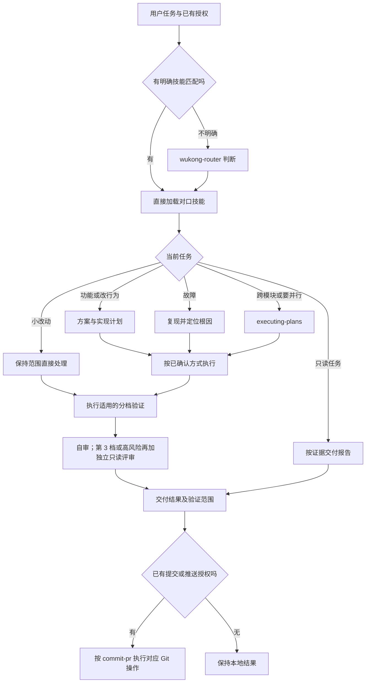

# wukong 技能全景：路由、职责与调用边界

wukong 是一套由代理读取的技能和本地工具，不是独立运行的 Agent 服务。Codex、Claude Code、Antigravity 提供会话和执行能力；本仓库提供技能描述、任务流程、宿主适配和确定性的配置工具。

当前版本 **1.0.34**，共 **34** 个技能：**20** 个可按描述自动选用，**14** 个保持显式调用。自动选用描述的是调用政策，不保证每轮必然触发。

[全景卡片图](architecture/wukong-panorama.html) · [组件关系图](architecture/wukong.html) · [安装与使用](../README.md)

## 两张图各看什么

**全景卡片图**是 4500 像素宽的单文件 HTML。上半部分画从任务到技能的四条路线：点名技能、小改动、主流程、复杂任务，再加一条钩子说明；下半部分按四个分区列出全部技能卡片，每张卡写「何时」和「作用」，标题链接到对应的 `SKILL.md`。浅色实底是自动技能，白底虚线是显式技能。路线是按需选用的示意，不代表每轮都跑完整流程。

| 分区 | 技能数 | 内容 |
|---|---|---|
| 入口与配置 | 2 | 路由、初始化（全局规则与四角色子代理模型） |
| 工作模式 | 2 | 架构先行、长任务决定记录 |
| 开发主流程 | 15 | 需求澄清、项目记录、方案、计划、执行（含 Antigravity 原生群体协调）、调试、测试、代码规范、审查、提交和发版 |
| 专项技能 | 15 | 理解架构、画图、界面设计与操作、MCP、视频、端到端测试、Word、写作、技能维护 |

设计原则不单独成卡，正文放在所属技能的 `references/principles/` 下：`code-style` 11 条，`brainstorming` 和 `systematic-debugging` 各 4 条，`executing-plans` 3 条，`writing-plans` 2 条，`test-strategy` 1 条。

**组件关系图**画的是逻辑职责，不是分别部署的服务。它的 [JSON 图源](architecture/wukong.architecture.json) 把每个节点的证据钉在提交 [a2c04b8](https://github.com/Acefake/s-skills/commit/a2c04b87c2dde4e57fa2fcaf26ec01d3be1d5a20)，可以追到具体文件和行号。

## 一、宿主、指令和技能各管一层

| 层次 | 负责什么 | 主要位置 |
|---|---|---|
| 宿主会话 | 提供模型、文件、终端、浏览器和代理能力；能力是否可用以当前会话为准 | Codex、Claude Code、Antigravity |
| 全局规则 | 指定如何匹配技能、何时验证、如何评审 | [AGENTS.md](../plugins/wukong/AGENTS.md) |
| 技能发现与路由 | 优先直接匹配；不明确时才由 wukong-router 判断；不覆盖显式调用政策 | [wukong-router](../plugins/wukong/skills/wukong-router/SKILL.md) 与各技能 frontmatter |
| 执行流程与能力 | 按任务使用方案、计划、调试、文档、界面、测试等技能 | [skills/](../plugins/wukong/skills/) |
| 宿主适配 | 把通用动作映射到当前宿主已有的工具，不编造能力 | [HOSTS.md](../plugins/wukong/HOSTS.md) |
| 钩子 | 会话开始自检、提示词评估、长命令和危险 git 命令提醒、本地使用日志 | [hooks/](../plugins/wukong/hooks/README.md) |
| 本地持久化 | 幂等同步受管全局规则和四角色子代理模型块，写入前确认 | [wukong-init](../plugins/wukong/skills/wukong-init/SKILL.md) |

三个宿主共用 `plugins/wukong` 里的技能源文件，各自通过插件清单分发：Claude Code 和 Codex 走市场入口，Antigravity 直接安装插件目录。它们不共享后台进程，也不共享其他机器上的配置。

## 二、任务先匹配，再按风险展开



- 小改动跳过方案和计划，不跳过对口技能和相称的自审。纯文案、样式数值等第 0 档改动只检查 diff，不因提交而补跑测试。
- 代码改动交付前由主任务自审：第 0、1 档只看 diff，第 2 档起加看关键调用方。第 3 档或涉及权限、并发、共享状态、数据删除的改动，再派只读子代理独立评审。无法委派时，明确说明缺少独立评审。
- 独立评审的授权不等于子代理开发的授权。实现是否委派，取决于已有授权。
- `executing-plans` 负责并行：Antigravity 上点名 swarm 时，主会话作为原生群体协调者派工；其他宿主改用当前可用的子代理派发或顺序执行。
- `architect`、`reflect` 等显式技能不因为“工具可用”就自动启用。`how` 也要点名，普通代码讲解直接回答。

## 三、安装和初始化是两个动作

| 动作 | 结果 | 不代表什么 |
|---|---|---|
| 安装或更新插件 | 宿主发现对应版本的技能 | 不改全局提示词，不保证当前会话立即重载 |
| 显式执行 `wukong-init` | 把当前版本的完整规则同步到受管标记块，再按宿主匹配检索、规划、审查、测试四个角色的模型和推理档位，写入模型块；整表确认后写入 | 不清空用户配置，不切换主会话模型，只影响这四类子代理 |
| 日常全局自检 | 每个主会话只读检查一次，缺失或过期时提醒 | 不自动初始化，不阻塞任务 |

全局规则的写入位置：

- Codex：实际 `CODEX_HOME` 下生效的 `AGENTS.override.md` 或 `AGENTS.md`。
- Claude Code：实际 `CLAUDE_CONFIG_DIR` 下的 `CLAUDE.md`。
- Antigravity：启用插件后直接加载 `rules/AGENTS.md` 和插件根 `hooks.json`；模型块和个人块写入 `~/.gemini/config/AGENTS.md`。

## 四、维护两张图

全景卡片图不随技能改动自动同步，也不参与 `check_marketplace.py` 检查。技能增删、调用政策或职责变化时手动更新：卡片数量、自动与显式的计数必须和 `plugins/wukong/skills/` 一致。

组件关系图改 [JSON 图源](architecture/wukong.architecture.json)，再在 `plugins/wukong/skills/archify` 下运行：

```text
node bin/archify.mjs finalize architecture <repo>/docs/architecture/wukong.architecture.json <repo>/docs/architecture/wukong.html --repo-root <repo> --quality showcase --json
```

它依次跑 schema 校验、仓库证据校验、产物检查和浏览器检查，全部通过才算完成。改动证据所在的文件后，把 `meta.repository.revision` 换成新的提交并核对行号。
