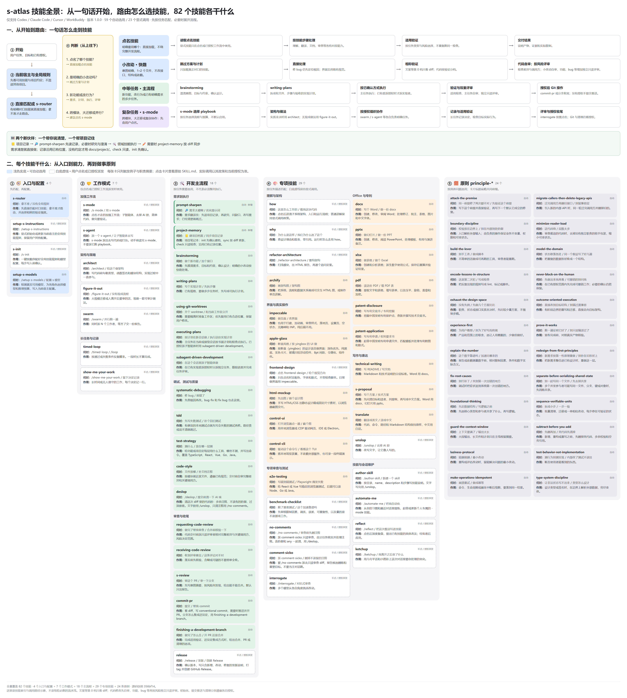
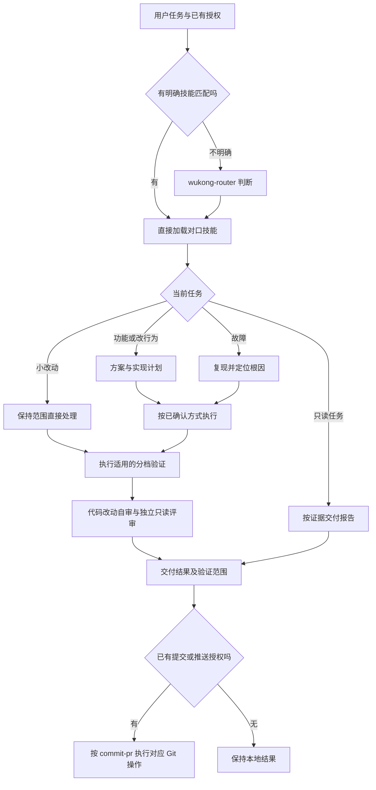

# wukong 技能全景：路由、职责与调用边界

wukong 是一套由代理读取的技能与本地工具，不是独立运行的 Agent 服务。Codex、Claude Code、Cursor、WorkBuddy 提供会话和执行能力；本仓库提供技能描述、任务流程、宿主适配和确定性的配置工具。

当前版本 **1.0.13**，共 **82** 个技能：**59** 个可按描述自动选用，**23** 个保持显式调用。自动选用描述的是调用政策，不保证每轮必然触发。

[全景卡片图源（HTML）](architecture/wukong-panorama.html) · [组件关系补充图](architecture/wukong.html) · [安装与使用](../README.md)

主图采用白底大画布：上半部分展示点名技能、小改动、普通开发及复杂任务的调用路线，下半部分以五个分栏展示全部技能。每张卡写出“何时”和“作用”；原则卡省略共同的 `principle-` 前缀，实际目录名不变。路线是按需选用的示意，不代表每轮必须执行全部流程。

| 分区 | 卡片数 | 内容 |
|---|---|---|
| 入口与配置 | 4 | 路由、全局提示词、模型配置、一键初始化 |
| 工作模式 | 7 | 加强流程、架构决策、协作、长任务与记录 |
| 开发主流程 | 18 | 需求到执行、调试测试、质量、审查与收尾 |
| 专项技能 | 29 | 理解架构、界面操作、专项审查、Office、专利和表达 |
| 做事原则 | 24 | 按具体问题选用的 `principle-*` |

主图和上表已覆盖 82 张卡片，包含 `prompt-sharpen`、`project-memory` 和显式调用的 `release`。浅色实底为自动技能，白底虚线为显式技能。卡片链接指向提交 356bf14 的源码快照（`release` 与 `automate-me` 卡片固定在 `ba550e7`），每个技能恰好出现一次，卡片标题链接到对应源码。HTML 是 4500 像素宽的独立可编辑图源，可缩小或横向浏览；PNG 预览可直接放大查看。

组件关系图作为补充保留，表示逻辑职责，不表示分别部署的服务。其 [JSON 图源](architecture/wukong.architecture.json) 的节点证据固定在 [cfd0823](https://github.com/Acefake/s-skills/commit/cfd0823ff5483f272bcd41f9bae7e3a377655220)，可追溯到具体文件和行号。

## 一、宿主、指令和技能各管一层

| 层次 | 负责什么 | 主要位置 |
|---|---|---|
| 宿主会话 | 提供模型、文件、终端、浏览器和代理能力；能力是否可用以当前会话为准 | Codex、Claude Code、Cursor、WorkBuddy |
| 全局规则 | 指定如何匹配技能、何时验证、如何评审 | [AGENTS.md](../plugins/wukong/AGENTS.md) |
| 技能发现与路由 | 优先直接匹配；不明确时才由 wukong-router 判断；不覆盖显式调用政策 | [wukong-router](../plugins/wukong/skills/wukong-router/SKILL.md) 与各技能 frontmatter |
| 执行流程与能力 | 按任务使用方案、计划、调试、文档、界面、测试等技能 | [skills/](../plugins/wukong/skills/) |
| 宿主适配 | 把通用动作映射到当前宿主已有工具，不编造能力 | [HOSTS.md](../plugins/wukong/HOSTS.md) |
| 本地持久化 | 幂等同步受管全局规则和模型配置，写入前确认 | [setup-s-instructions](../plugins/wukong/skills/setup-s-instructions/SKILL.md)、[setup-s-models](../plugins/wukong/skills/setup-s-models/SKILL.md)、[wukong-init](../plugins/wukong/skills/wukong-init/SKILL.md) |

三个市场入口共用 `plugins/wukong` 中的技能源文件，通过各自插件清单分发。它们不共享一个后台进程，也不自动共享其他机器上的配置。

## 二、任务主线先匹配，再按风险展开

- 小改动跳过方案和计划，不跳过对口技能及相称的自审。纯文案、样式数值等第 0 档改动只检查 diff，不因提交而补跑测试。
- 代码修改交付前由主任务自审完整差异和关键调用方，第2档以上或高风险改动再由只读子代理独立评审；风险决定评审范围。无法委派时明确缺少独立评审。
- 独立评审授权不等于子代理开发授权。当前会话或接续会话可由主任务执行计划；实现委派仍取决于已有授权。
- `wukong-mode`、`architect` 和 `reflect` 等显式技能不因为“工具可用”就自动启用。`how` 也需点名，普通代码讲解可以直接回答。

## 三、安装和初始化是两个动作

| 动作 | 结果 | 不代表什么 |
|---|---|---|
| 安装或更新插件 | 宿主发现对应版本的技能 | 不自动改全局提示词，不保证当前会话立即重载 |
| 显式执行 `setup-s-instructions` | 将当前版本完整规则同步到受管标记块，保留其他内容 | 不清空用户配置 |
| 显式执行 `setup-s-models` | 一步一问选预算和六角色模型，确认后写入模型标记段 | 不切换主会话模型，只影响技能派出的子代理 |
| 显式执行 `wukong-init` | 按顺序做上面两步，每步写入前确认，最后汇总 | 不替用户预选预算或模型 |
| 日常全局自检 | 每个主会话只读检查一次，缺失或过期时提醒 | 不自动初始化，不阻塞任务 |

Codex 使用实际 `CODEX_HOME` 下生效的 `AGENTS.override.md` 或 `AGENTS.md`；Claude Code 使用实际 `CLAUDE_CONFIG_DIR` 下的 `CLAUDE.md`。WorkBuddy 使用兼容文件 `~/.codebuddy/CODEBUDDY.md`，项目技能安装到 `.codebuddy/skills/`；本机与云端分开。Cursor 使用全局 User Rules，有真实设置编辑能力时才自动操作；否则提供待粘贴内容并标明尚未配置，项目 Always 规则不能冒充全局规则。

## 四、源码证据和维护方式

主图维护 [全景 HTML](architecture/wukong-panorama.html)：保留上方路由、下方五栏和卡片的“何时／作用”，同步技能总数、分区数量与自动／显式政策。更新后核对每个技能恰好出现一次、卡片文字无溢出，再以浏览器截图更新 PNG。当前预览为 4500×4450，不裁掉卡片或页脚。不要用组件关系图替代全景卡片主图。

组件关系补充图单独维护 [JSON 图源](architecture/wukong.architecture.json)，使用 `archify finalize architecture` 生成其 HTML，并保留仓库证据校验、严格产物检查和浏览器检查。它与主图是两种视角，不共用 PNG 预览。

