# 讲解页编写

讲解页把一个有结论、有一定结构的回答（解释、比较、决策、诊断、评审或计划）变成一个页面。页面以结论开头，并用面板展示推理过程：图、表格、步骤和简短文字。何时制作讲解页以及可选启用的模式，见 Skill 中的“Choose the artifact”。要求画一个系统时，使用原生图类型。

本指南就是完整的草稿语言。直接据此编写草稿。

## 草稿

编写一个 Markdown 文件 `candidate.archify.md`。标题之后的第一段是直接结论。紧随其后的一个扁平列表给出最多四条理由。每个 `##` 标题开启一个面板。

```md
# Why does the first HTTPS visit take an extra round trip? {#tls-first-visit}

The browser and server must agree on keys before any request is sent: **one extra round trip** with TLS 1.3.

- The browser sends its key share in the first message, so one round trip is enough.[](source:rfc8446)
- The server replies with its key share, then its certificate, already encrypted.
- A returning browser can resume and send data immediately.

@answer scope="TLS 1.3 · first visit · no proxy"
@meta locale=en
@source rfc8446 title="RFC 8446: TLS 1.3" url=https://www.rfc-editor.org/rfc/rfc8446

## What is exchanged before the first request? {#handshake}

@sequence id=handshake-flow title="TLS 1.3 full handshake"
| actor browser | Browser | frontend |
| actor server | Server | backend |
| browser | server | ClientHello + key share |
| server | browser | ServerHello + key share | return |
| server | browser | Certificate + Finished (encrypted) | return |
| browser | server | Finished + GET / | emphasis |
| server | browser | 200 OK | return |

@steps id=handshake-steps
| hello | ClientHello | Offers cipher suites and a key share. | handshake-flow | browser |
| reply | ServerHello | Picks a suite and sends its key share; the certificate follows encrypted. | handshake-flow | server |
| done | Finished | Both sides confirm the keys; the request rides along. | handshake-flow | browser |

## How does TLS 1.3 compare with 1.2? {#versions}

| Criterion | TLS 1.2 | TLS 1.3 |
| --- | --- | --- |
| Round trips before data | Two {caution:Slower} | One {good:Faster} |
| Resumed connection | One | Zero {good:0-RTT} |
```

使用 [交付](#delivery) 中的命令交付它。

### 保证草稿有效的规则

- ID 在整个文档内唯一：面板、块、图和步骤共用一个命名空间。只有当某个步骤、链接或补丁指向某个块时，才给它一个 `id`；callout、facts 和列表上省略它。按图的内容命名图（`handshake-flow`），而不是按其所在面板命名（`handshake`）。
- 正文是纯文本。文件路径、glob、`<placeholders>`、运算符和代码都要用反引号包住：正文中裸露的 `<`、`>` 或 `*` 会被当作 HTML 或强调而失败。行内代码按原样显示。
- 指令行是管道行，每行一条，每条的单元格数必须与文档规定一致：`| first | second |`。单元格内的字面管道符写作 `\|`。空行或下一个 `##` 或 `@` 行结束这些行。
- 指令参数为 `key=value`；含空格的值用双引号括起并使用 JSON 转义。
- 用下面的紧凑行绘制原生图。内联 JSON spec 只用于例外情形。
- 嵌套列表、原始 HTML 和其他 Markdown 扩展会失败，并给出带定位的诊断，指出行号、组件和一个修复示例。

## 按信息的形态选择形式

一张图取代原本描述它的那段文字。当回答涉及关系、流程、随时间的交换、层级、历史或数据模型时，就把它画出来。典型的页面包含结论、一张图以及一到两个表格或步骤列表。

| 信息的形态 | 形式 |
| --- | --- |
| 各方之间按顺序传递的消息：协议、请求路径 | `@sequence` |
| 带步骤和分支的流程：分诊、发布、审批 | `@workflow` |
| 系统的组成部分及其连接方式 | `@architecture` |
| 层级：目录、模块、分类体系 | `@tree` |
| 随时间发生的事件：事故、版本发布 | `@timeline` |
| 带字段和关系的实体 | `@erd` |
| 在多个标准上比较的选项 | 带 `{good:…}`、`{caution:…}`、`{bad:…}` 单元格的 Markdown 表格 |
| 有序的操作、检查或阶段 | `@steps` |
| 读者必须执行或核实的事项 | 任务列表，`- [ ] item` |
| 警告、未决问题或关键注意事项 | `@callout` |
| 少量带标签的事实 | `@facts` |
| 在各项之间或随时间比较的数字、整体中的占比、2×2 优先级、数量的流动 | ```` ```mermaid ```` 图表围栏 |
| 一个数字与某个上限的对比 | `@metric` |
| 仓库中已存在的代码 | `@code` |
| 对代码的修改 | `@diff` 或 ```` ```diff ```` 围栏 |
| 尚不存在的命令、配置或代码 | 普通围栏 |

逐步讲解一张图的步骤属于该图所在的面板：页面在图旁边阅读它们，每一步点亮图中对应部分，读者可以逐步浏览。每个步骤的标题用它所指节点的标签，让文字和图一眼就能对上；detail 列说明在那里要做什么。

小回答配小页面：结论加一到两个面板。原理说明、诊断或检查清单类问题通常需要三到五个面板。

## 写作 <a id="writing"></a>

为会依据该页面采取行动、并可能核查它的读者写作。使用用户的语言。

- 结论最先被阅读；它之后的每个面板都用于支撑、限定或应用它。没有可支撑的内容时就停止。
- 覆盖读者依据回答行动所需的内容：结论背后的机制、如何核查它，以及它不成立的情形。细心的读者会问的下一个问题，要有一个面板、一行表格或 scope 中的一行来回答；读者缺了它就可能弄错的事实不是可选的。
- 每个面板只回答一个问题，每句话只做一个断言。表格或图已经展示的断言不再重复；文字补充其原因或例外。
- 在标题、面板、图标签和表头中，每个事物只用一个术语，并优先使用读者自己的术语。页面会把正文中的名称链接到带有该标签的节点，让读者能在图中指向它。
- 给出结果时附上证据：带单位的数字、文件位置、来源。当某个值未知或为估计值时，在 scope 中说明。
- 对读者无法独自核查的每个断言引用一个 `@source`：协议细节、阈值、基准数据、API 行为。没有来源的经验法则要标明是经验法则，或者不写。
- 交付前重新计算每个派生数字，并展示一次算式：“1000 个请求中 990 个为 80 ms → P99 = 80 ms；11 个慢请求 → P99 = 600 ms。”表格中的合计要能加总吻合。
- 把操作写成祈使句，并把触发条件放在前面：“如果迁移报告 schema 不匹配，先回滚再重试。”
- 当读者必须执行或核实时，以一个检查清单面板结尾：`- [ ] item`，每项一个具体检查。读者可以在页面上勾选各项。

英文：短句（约 25 个词以内），常用词（use, before, to, because），主动语态并点明执行者。

中文：短句，每句不超过约 50 字；动词直接用（检查、决定，而不是进行检查、做出决定）；一句话里的“的”不超过两个；数字后写清边界（超过 3 次、不超过 1 秒）；用具体结果代替套话（赋能、全方位、至关重要）。

## 紧凑原生图

写 `@<type> id=<diagram-id> title="..."`，后接管道行。每一个都会编译成完整的原生 Archify 图，带有原生校验和布局，并可从页面在完整查看器中打开。一个文档最多容纳四张原生图。

任何节点、角色或实体行都可以以一个 `source:<id>` 单元格结尾，指向一个已声明的 `@source`；悬停该节点会显示来源，若为仓库文件则显示其固定的行，因此一张代码图同时也是一次代码导览。

节点和参与者类型：`frontend`、`backend`、`database`、`cloud`、`security`、`messagebus`、`external`（默认 `backend`）。连线和消息的 variant：`default`、`emphasis`、`security`、`dashed`；sequence 还接受 `return`。ID 以字母开头，只使用字母、数字、`-` 和 `_`。

**`@sequence`**：先声明角色，再按顺序列出消息。

```md
@sequence id=cache-read title="Cache miss"
| actor api | Order API | backend |
| actor redis | Redis | database |
| api | redis | GET order:42 |
| redis | api | nil | return |
```

角色行：`actor <id> | label | type`。消息行：`from | to | label | variant?`，其中 `from` 和 `to` 是角色 ID 或标签。`phase | label` 行在其后的消息上开启一个带标签的区带，直到下一个 phase：`phase | TCP handshake (1 RTT)`。

**`@workflow`** 和 **`@architecture`**：先节点，后连线。摆放沿连线从左到右进行，从没有入边的节点开始。

```md
@workflow id=triage title="Latency triage"
| alert | Alert fires | external |
| split | Check percentiles | backend |
| trace | Compare slow traces | backend |
| fix | Fix the cause | backend |
| alert > split | |
| split > trace | tail only |
| trace > fix | cause found | emphasis |
```

节点行：`id | label | type?`。连线行：`from > to | label? | variant?`。节点会加宽以容纳其标签，所以节点标签用几个词命名该步骤（最多约 10 个汉字或 4 个英文单词），由 `@steps` 承载细节。连线标签保持一到两个词。以 `?` 结尾的节点标签会被画成判断节点；给它的出边标上答案（`yes`、`no`、`是`、`否`）。

把流程的步骤分组为阶段：声明 `lane <id> | label` 行，然后把每个 workflow 节点所属的阶段写在第四个单元格中。最多六个节点画成一行，阶段标签位于其上方；更长的流程会换行，每个阶段一行。

```md
@workflow id=p99-flow title="P99 triage"
| lane confirm | Confirm the symptom |
| lane locate | Locate the cause |
| alert | P99 up, mean flat | external | confirm |
| window | Align window and percentiles | backend | confirm |
| sample | Sample slow requests | backend | locate |
| fix | Fix and verify | backend | locate |
| alert > window | |
| window > sample | tail grew |
| sample > fix | cause | emphasis |
```

Architecture 允许十二列。相互通信的组件用 `@architecture`，读者依次执行的步骤用 `@workflow`。

**`@tree`**：每个节点一行，`id | label | parent`；根节点的 parent 为 `-`。

```md
@tree id=package-layout title="Package layout"
| root | archify | - |
| bin | bin | root |
| explainer | explainer | root |
```

**`@timeline`**：可选的泳道行，然后是事件，`id | ISO time with offset | title | lane? | kind?`。类型：`default`、`change`、`alert`、`action`、`recovery`。

```md
@timeline id=incident title="Checkout incident"
| lane ops | Operations |
| deploy | 2026-10-01T10:00:00+08:00 | Deploy v2 | ops | change |
| alarm | 2026-10-01T10:12:00+08:00 | Error rate alarm | ops | alert |
```

简写形式的时间线会被标注为示意性的，并以 UTC 显示时间。

**`@erd`**：先实体，再字段，然后是关系。

```md
@erd id=order-model title="Orders"
| entity user | User |
| entity order | Order |
| user.id | bigint | pk |
| order.id | bigint | pk |
| order.user_id | bigint | fk | user.id |
| order > user | many:one | placed by |
```

字段行：`entity.field | type | keys? | references?`，键为 `pk`、`fk`、`uk`，以逗号分隔。关系行：`from > to | one:one|one:many|many:one|many:many | label?`。

其他原生类型（`dataflow`、`lifecycle`、`class`、`waterfall`）以及需要显式几何的图，使用同目录下的 spec 文件：`@diagram dataflow source=events.dataflow.json`，按 Skill 的原生编写流程编写。

## 图表

用 ```` ```mermaid ```` 围栏可以根据数字绘制图表：`pie`、`xychart-beta`（柱状图和折线图）、`quadrantChart`、`sankey-beta`、`radar-beta` 或 `venn-beta`。页面会以页面主题把它渲染成静态 SVG。可选的 `title="..."` 会成为图注。

````md

```mermaid title="Latency before and after the release (ms)"
xychart-beta
  x-axis ["Mean", "P50", "P99"]
  y-axis "ms" 0 --> 700
  bar "Before" [80, 75, 80]
  bar "After" [88, 76, 600]
```

````

给每个序列命名（`bar "Before" [...]`），让图表获得图例。柱子显示其数值，饼图图例显示每个值及其占比。排名类条目或较长的类别名使用 `xychart-beta horizontal`。当数字承载要点时，例如一个值跳升而其他值保持平稳、前后对比或占比，就把它们画成图表，让对比一眼可见；图表下方的表格只补充每个数字所需的文字。把对比放在一张图表里，例如发布前后的均值、P50 和 P99。

当数字位于草稿旁边的 CSV 或 JSON 文件中时，直接对该文件绘图，而不是复制其中的值：`@chart type=bar|line|pie data=latency.csv x=day y=p50,p99 unit=ms title="..."`。`x` 指定标签列，`y` 为每个序列指定一个值列（饼图使用第一个）。CSV 需要表头行；JSON 是对象数组。该文件在交付时读取并冻结，最多 60 行（饼图 12 行）。空值是错误，不是零：要么填上，要么去掉该行并在图注中说明。

图表与正文一样，要说明其数字的来源：实测、来自某个来源、估计或示意，写在图注或 scope 中。凡含空格或非 ASCII 文本的标签都要加引号。流程图、时序图、类图、ER 图、状态图、时间线和思维导图类的 Mermaid 使用上面的原生简写，Archify 会校验它们并让读者探索。

## 指令参考

| 指令 | 头部参数 | 行 |
| --- | --- | --- |
| `@answer` | `scope="..."` | 无 |
| `@meta` | `locale`（`en`、`zh-CN`、`zh-TW`、`es`、`ko`、`ar`）、`quality_profile`、`style`（`clean`、`editorial`、`product`、`swiss`；读者可切换）、`repo_url`、`repo_revision` | 无 |
| `@source <id>` | `title`、`url`，或 `path` 加 `lines=start:end` | 无 |
| `@steps` | `id` | `id | title | detail? | diagram-id? | node? | from~to? | edge-ids?`（node 与路由互斥） |
| `@callout` | `id`、`level=note|warning|open-question`、`title` | 每行一个单元格；各行合并为段落 |
| `@facts` | `id` | `label | value` |
| `@metric` | `id`、`label`、`value`、`limit`、`unit`、`note`、`typical=true` | 无；必须有 `value` 或 `limit` |
| `@comparison` | `id`、`columns="A,B"`、`label` | `criterion | cell per option` |
| `@prose` | `id`、`text` | 每行一个单元格 |
| `@list` | `id`、`ordered=true` | 每行一个单元格 |
| `@code` | `id`、`source=<source-id>`、`language` | 无 |
| `@diff` | `id`、`caption` | 紧随其后的 ```` ```diff ```` 围栏 |
| `@image` | `id`、`path`、`alt`、`caption` | 无 |
| `@chart` | `type`（`bar`、`line`、`pie`）、`data`（`.csv` 或 `.json`）、`x`、`y`、`unit`、`title`、`id` | 无 |
| `@<diagram type>` | `id`、`title`、`changes` | 上文的紧凑行 |
| `@diagram <type>` | `id`、`source`、`title` | 无 |

普通段落、扁平列表和 Markdown 表格不需要指令。表格的第一个表头单元格是行标签列的标题；比较单元格可以以 `{good:Label}`、`{caution:Label}` 或 `{bad:Label}` 结尾，行标签可以以 `{#row-id}` 结尾。只标记决定比较结果的单元格，通常每行一到两个；每个单元格都带徽标会显得杂乱。

普通围栏（```` ```bash title="Run the tests" ````）是带复制按钮的字面代码片段。`@code` 从来源的 Git 提交和行范围中获取真实摘录；它不接受手写的代码文本。`@image` 嵌入一张位于受限目录内的本地 PNG、JPEG、GIF 或 WebP 图片。

## 行内链接与来源

支持 `**bold**`、行内代码和安全的 HTTP(S) 链接。`[Redis](node:cache-read.redis)` 和 `[path](route:cache-read.api~redis)` 会在已存在的目标处打开原生查看器。`[details](block:next)` 在页面内跳转。

`[reference text](source:docs)` 渲染为该文字后接一个编号上标；`[](source:docs)` 只渲染上标。编号按首次出现的顺序排列；未被引用的来源按声明顺序排在其后。页脚列出带 URL 或仓库位置的标题。

```md
@source router title="Request handler" path=src/router.js lines=10:30
@code source=router language=js
```

代码摘录需传入 `--repo-root /path/to/repository`。传入后，每个带行范围的已引用仓库来源，在读者悬停引用时也会显示其固定的行；无法核实的来源仍是普通引用。工具会解析 origin 和 HEAD，或接受 `@meta repo_url=... repo_revision=<full-commit>`。提交、路径和行范围必须存在；工作区中的修改不能替代已提交的字节。

`[5 ms](typical:Description of the value)` 会变成静态脚注，打印时也是如此。

## 面板与布局

每个面板标题优先用一个具体的问题。`{#id}` 为链接和面板替换提供稳定的 ID；`{#id span=7}` 把宽度固定为 1–12 列。省略 span：页面会测量每个面板并规划整体版面，保持源顺序且结论位于左上角，给每张图足够宽度以保证标签可读，并避免表格和代码被截断。没有 JavaScript、宽度低于 1100 px 以及打印时，使用静态宽度。

## 交付 <a id="delivery"></a>

```sh
node archify/bin/archify.mjs finalize explainer candidate.archify.md answer.html --json
```

通过后，用两到三行回复：先写结论，然后给出指向该页面、带描述性标题的 Markdown 链接。不要列出各项关卡。当用户要求了这个页面，且上下文中没有 `[archify explainer: ...]` 规则行时，以 Skill 的 Output 部分中那一行模式提议结尾。

当草稿使用 `@code` 时，加上 `--repo-root <path>`。finalize 会校验、原子化地交付并检查 HTML；它不会启动浏览器，其回执会把浏览器关卡记录为未运行。失败时会指出行号、组件、原因和一个修复示例；修复草稿后重新运行，输出到同一路径。

写作警告应用 [写作](#writing) 规则：超过 50 个中文单位或 28 个英文单词的句子，超过四句或 120 个单位的段落，连用的“的”，虚化动词，套话，开场白和结束语，无边界的数量，数字后的“以上/以下/以内”，有常用替代词的长英文单词，在 scope 之外出现的“示例”、“未实测”或“illustrative”之类限定语，大部分加粗的结论，以及超过 50 个单位的 scope。每条警告都会指出匹配到的文字和一个修复方法；若修复能保留原意，就照做。`--writing warn|strict|off` 设置严重程度。

## 面板替换

```sh
node archify/bin/archify.mjs patch explainer answer.html next replacement.md revised.html --json
```

替换文件包含一个具有相同稳定 ID 的 `##` 面板；未改动的内容和已冻结的资源会被保留。修改共享来源、结论或文档级结构时，对完整草稿重新运行 finalize。
