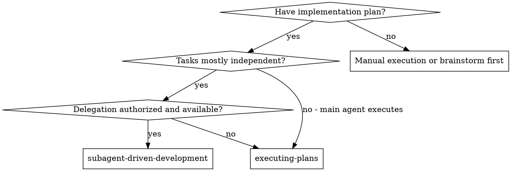
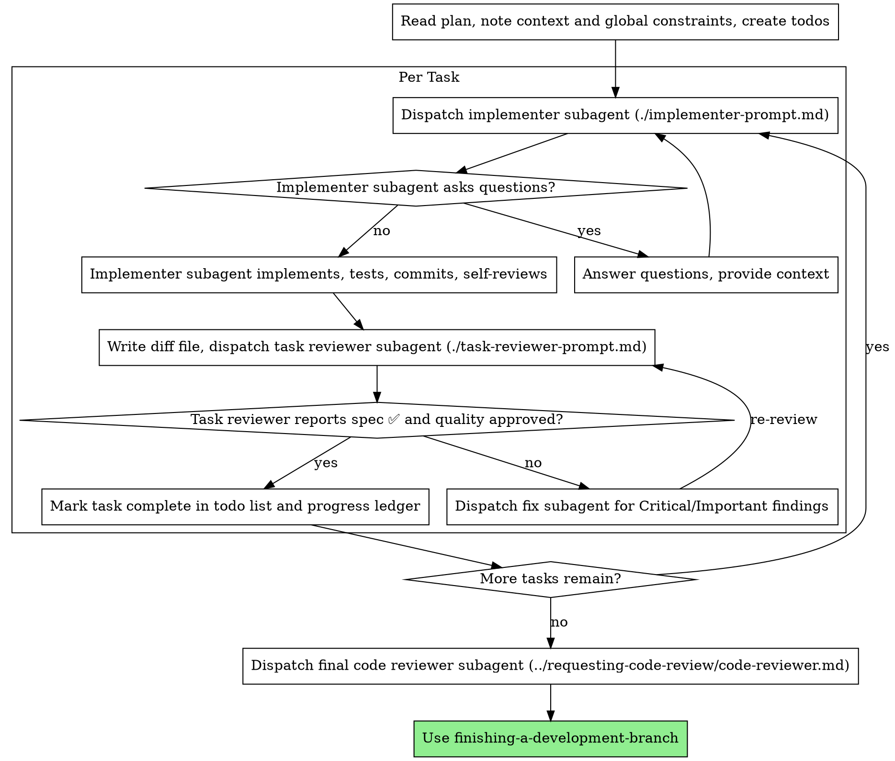

本会话首次使用本库技能时，按[全局提示词自检](../setup-s-instructions/references/daily-check.md)只读检查一次。
## 运行环境适配

涉及宿主工具、模型配置或子代理时，按需阅读[宿主适配](../../HOSTS.md)。

# 子代理驱动开发

按任务派发全新的实现者子代理来执行计划：每项任务之后做一次任务评审（规格符合性 + 代码质量），最后再做一次覆盖整个分支的宽泛评审。

**为何使用子代理：** 你把任务委托给上下文隔离的专职代理。通过精确编写它们的指令和上下文，确保它们保持聚焦并完成任务。它们绝不应继承你本次会话的上下文或历史——你只构造它们真正需要的内容。这也为你自己保留协调工作所需的上下文。

**核心原则：** 每项任务使用全新子代理 + 任务评审（规格 + 质量） + 收尾时的宽泛终审 = 高质量、快速迭代

**叙述：** 在工具调用之间，最多用一行简短叙述——台账和工具结果承担记录。

**持续执行：** 不要在任务之间停下来向人类伙伴确认。按计划执行全部任务，中途不要停下。唯一可以停下的理由是：你无法解决的 BLOCKED 状态、真正阻碍进展的歧义，或全部任务已完成。「要我继续吗？」这类询问和进度摘要会浪费他们的时间——他们要求你执行计划，那就执行。

## 何时使用

**与主任务执行的区别：**
- 同一会话（无需切换上下文）
- 每项任务使用全新子代理（避免上下文污染）
- 每项任务之后评审（规格符合性 + 代码质量），最后做宽泛评审
- 迭代更快（任务之间没有人在回路中）

## 流程

下文的测试、提交和台账要求服从 s-router 验证分档与已有任务授权。未授权提交时，报告未提交状态和改动文件，不为生成评审包而提交。`scripts/review-package BASE HEAD` 仅含提交差异，必须另附暂存、未暂存和相关新文件内容；基线时已有的无关修改单独标明并保留。

## 细则文件

上面的图只排顺序。进入下表任一步之前，先读对应文件再做。危险信号和集成在开工前读。

| 步骤 | 文件 |
| --- | --- |
| 派发任务 1 之前，审查计划里的矛盾 | [preflight-plan-review.md](references/preflight-plan-review.md) |
| 为每个角色选模型 | [model-selection.md](references/model-selection.md) |
| 按实现者回报的状态处理 | [implementer-status.md](references/implementer-status.md) |
| 评审者标了无法从 diff 核实的条目 | [reviewer-warnings.md](references/reviewer-warnings.md) |
| 构造评审者提示词、修复派发和终审包 | [reviewer-prompts.md](references/reviewer-prompts.md) |
| 用文件交接简报、报告和 diff | [file-handoff.md](references/file-handoff.md) |
| 用台账记进度，压缩后从台账恢复 | [progress-ledger.md](references/progress-ledger.md) |
| 对照一轮完整例子 | [example-workflow.md](references/example-workflow.md) |
| 对照手工执行和 executing-plans | [advantages.md](references/advantages.md) |
| 危险信号，以及提问、评审失败、任务失败时怎么处理 | [red-flags.md](references/red-flags.md) |
| 要一起使用的技能 | [integration.md](references/integration.md) |

## 提示词模板

- [implementer-prompt.md](implementer-prompt.md) - 派发实现者子代理
- [task-reviewer-prompt.md](task-reviewer-prompt.md) - 派发任务评审者子代理（规格符合性 + 代码质量）
- 覆盖整个分支的终审：使用 requesting-code-review 的 [code-reviewer.md](../requesting-code-review/code-reviewer.md)
