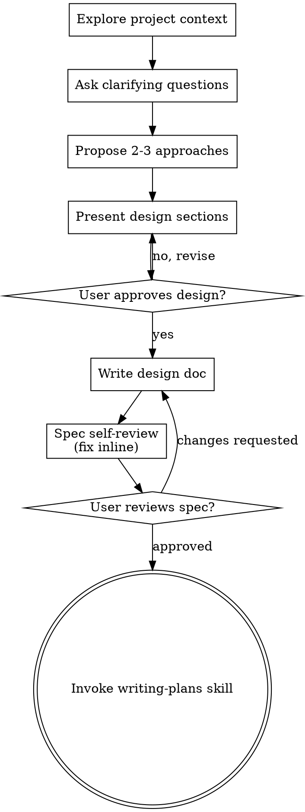

## 运行环境适配

在 Codex 或 T3 Code 中，执行前先阅读[宿主适配规则](../../HOSTS.md)；其中的模型、委派、浏览器和定时任务规则优先于下文的 Cursor 专用示例。

本技能译自 Jesse Vincent 的 Superpowers（MIT）。许可证见上一级文件夹的 `LICENSE-superpowers`。

# 把想法头脑风暴成设计

通过自然的协作对话，把想法变成充分成形的设计与规格。

先理解当前项目的上下文，然后一次问一个问题来打磨想法。一旦你明白要做的是什么，就呈现设计，并取得用户批准。

<HARD-GATE>
在你呈现设计并且用户批准之前，不要调用任何实现技能，不要写任何代码，不要搭建任何项目，也不要采取任何实现行动。无论你觉得项目有多简单，这条适用于每一个项目。
</HARD-GATE>

## 反模式：「这太简单了，不需要设计」

每个项目都走这个过程。一个待办清单、一个单函数工具、一处配置修改——全部如此。「简单」项目正是未经检验的假设最浪费工作的地方。设计可以很短（真正简单的项目用几句话就够），但你必须把它呈现出来并取得批准。

## 清单

你必须为下面每一项建立任务，并按顺序完成：

1. **探索项目上下文** — 检查文件、文档、最近的提交
2. **在恰当时机提供视觉伴侣** — 不要一上来就提供。第一次出现「展示出来确实比描述更清楚」的问题时，再提供（单独一条消息）；用户同意后，浏览器标签页会为你打开。如果从头到尾都没有视觉问题，就不要提供。见下面的「视觉伴侣」一节。
3. **提出澄清问题** — 一次一个，弄清目的、约束、成功标准
4. **提出 2-3 种做法** — 带上取舍和你的推荐
5. **呈现设计** — 按各部分的复杂度分节呈现，每一节之后取得用户批准
6. **写设计文档** — 保存到 `docs/superpowers/specs/YYYY-MM-DD-<topic>-design.md` 并提交
7. **规格自检** — 就地快速检查占位符、矛盾、含糊和范围（见下文）
8. **用户审阅写好的规格** — 继续之前，请用户审阅规格文件
9. **过渡到实现** — 调用 writing-plans 技能来创建实现计划

## 流程

**终态是调用 writing-plans。** 不要调用 frontend-design、mcp-builder 或任何其他实现技能。头脑风暴之后，你唯一要调用的技能是 writing-plans。

## 过程

**理解这个想法：**

- 先查看当前项目状态（文件、文档、最近的提交）
- 在问细节问题之前，先判断范围：如果请求描述了多个相互独立的子系统（例如「做一个带聊天、文件存储、计费和分析的平台」），立刻指出来。不要把问题花在打磨一个首先需要拆开的项目的细节上。
- 如果项目大到一份规格装不下，帮助用户拆成子项目：独立的部分有哪些、它们如何关联、应该按什么顺序做？然后用正常的设计流程对第一个子项目做头脑风暴。每个子项目都有自己的规格 → 计划 → 实现循环。
- 对范围合适的项目，一次问一个问题来打磨想法
- 能用选择题时优先用选择题，开放式问题也可以
- 每条消息只问一个问题——如果某个话题需要更多探索，把它拆成多个问题
- 聚焦于理解：目的、约束、成功标准

**探索做法：**

- 提出 2-3 种不同做法，并说明取舍
- 用对话的方式给出选项，带上你的推荐和理由
- 先说你推荐的选项，并解释为什么

**呈现设计：**

- 一旦你相信自己理解了要做的东西，就呈现设计
- 按复杂度缩放每一节：直白的用几句话，比较微妙的最多写 200-300 词
- 每一节之后问，到目前为止看起来对不对
- 覆盖：架构、组件、数据流、错误处理、测试
- 如果有地方说不通，准备退回去澄清

**为隔离和清晰而设计：**

- 把系统拆成更小的单元，每个单元只有一个清楚的目的，通过定义明确的接口通信，并且可以独立理解和测试
- 对每个单元，你应当能回答：它做什么、怎么用它、它依赖什么？
- 别人能否不读内部实现就明白一个单元做什么？你能否改内部实现而不破坏使用方？如果不能，边界还需要再打磨。
- 更小、边界清楚的单元也更容易让你工作——你一次能放进上下文的代码，推理得更好；文件聚焦时，你的修改更可靠。文件变大，常常说明它承担了太多。

**在已有代码库里工作：**

- 提议改动之前，先探索当前结构。遵循已有的模式。
- 如果现有代码的问题会影响这项工作（例如某个文件已经太大、边界不清、职责缠在一起），把有针对性的改进写进设计——就像好的开发者会改进自己正在改的代码那样。
- 不要提议无关的重构。盯住服务于当前目标的事。

## 设计完成之后

**文档：**

- 把已经确认的设计（规格）写到 `docs/superpowers/specs/YYYY-MM-DD-<topic>-design.md`
  - （用户对规格存放位置的偏好覆盖这个默认值）
- 如果有 elements-of-style:writing-clearly-and-concisely 技能，就使用它
- 把设计文档提交到 git

**规格自检：**
写完规格文档后，用新的眼光再看一遍：

1. **占位符扫描：** 有没有 "TBD"、"TODO"、没写完的小节，或含糊的需求？把它们补上。
2. **内部一致性：** 有没有小节互相矛盾？架构和功能描述对得上吗？
3. **范围检查：** 这是否足够聚焦，能做成一份实现计划，还是需要拆开？
4. **含糊检查：** 有没有哪条需求可以被理解成两种意思？如果有，选定一种，并写明确。

就地修好问题。不需要再审一遍——修好，然后继续。

**用户审阅关卡：**
规格审阅循环通过之后，继续之前请用户审阅写好的规格：

> 「规格已经写好并提交到 `<path>`。请审阅。如果在我们开始写出实现计划之前你想做任何修改，请告诉我。」

等待用户的回应。如果他们要求修改，改完并重新跑规格审阅循环。只有用户批准之后才继续。

**实现：**

- 调用 writing-plans 技能，创建一份详细的实现计划
- 不要调用任何其他技能。下一步就是 writing-plans。

## 关键原则

- **一次一个问题** - 不要一次抛出多个问题
- **优先选择题** - 能用的时候，选择题比开放式问题更容易回答
- **无情地 YAGNI** - 从所有设计里去掉不必要的功能
- **探索替代方案** - 定下来之前，总是先提出 2-3 种做法
- **逐步确认** - 呈现设计，继续之前先取得批准
- **保持灵活** - 有地方说不通时，退回去澄清

## 视觉伴侣

一个基于浏览器的伴侣，用来在头脑风暴期间展示草图、示意图和视觉选项。它是一个工具，不是一种模式。接受这个伴侣，意味着那些适合用视觉方式处理的问题可以用它；这并不意味着每个问题都要经过浏览器。

**在恰当时机提供伴侣：** 不要一上来就提供。等到某个问题确实是看比说更清楚的时候——真正的草图 / 布局 / 示意图问题，而不只是一个界面*话题*。第一次出现这种情况时再提供，并且单独作为一条消息：
> 「下一部分如果我展示给你看，可能会更容易——我可以一边往下做，一边在浏览器标签页里放上草图、示意图和对比。它还比较新，token 消耗可能比较大。要我这么做吗？我会为你打开。」

**这次提供必须单独成一条消息。** 只有这段邀请——不要夹带澄清问题、摘要或其他内容。等待用户的回应。如果他们接受，用 `--open` 启动服务器，这样他们的浏览器会自动打开第一屏。如果他们拒绝，继续只用文字，并且不要再提供，除非他们自己提起。

**逐题决定：** 即使用户已经接受，也要针对每一个问题决定用浏览器还是用终端。检验标准是：**用户看一眼是否比读一段文字更容易理解？**

- **用浏览器**呈现本身就是视觉的内容——草图、线框、布局对比、架构图、并排的视觉设计
- **用终端**呈现文字内容——需求问题、概念上的选择、取舍列表、A/B/C/D 文字选项、范围决策

一个关于界面话题的问题，并不自动就是视觉问题。「在这个上下文里，个性是什么意思？」是概念问题——用终端。「哪种向导布局更好？」是视觉问题——用浏览器。

如果他们同意使用伴侣，继续之前先阅读详细指南：
`skills/brainstorming/visual-companion.md`
