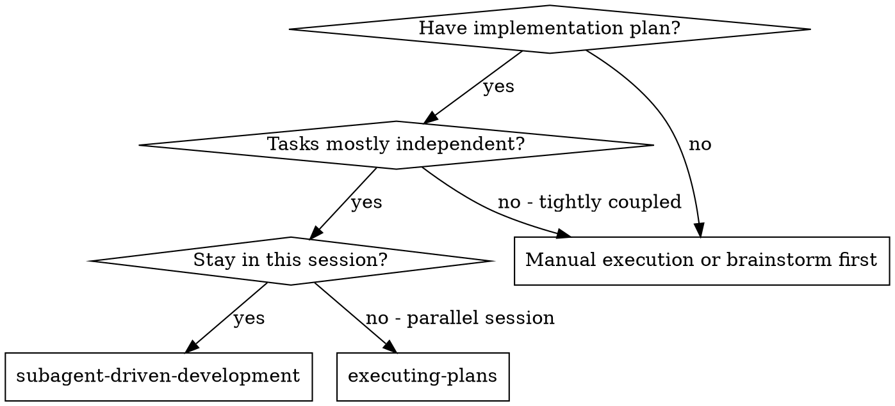
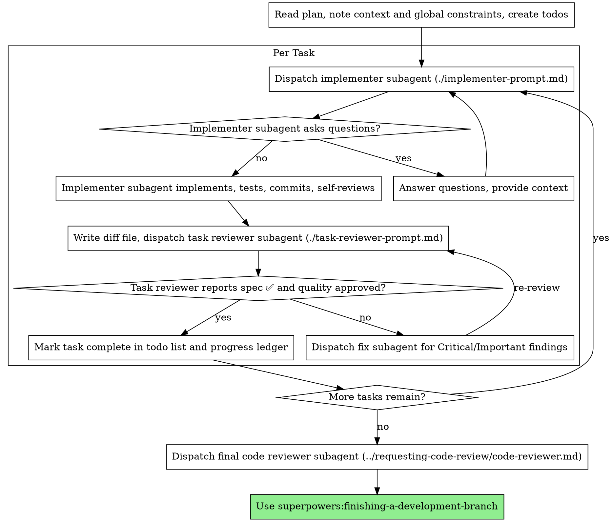

## 运行环境适配

在 Codex 或 T3 Code 中，执行前先阅读[宿主适配规则](../../HOSTS.md)；其中的模型、委派、浏览器和定时任务规则优先于下文的 Cursor 专用示例。

本技能译自 Jesse Vincent 的 Superpowers（MIT）。许可证见上一级文件夹的 `LICENSE-superpowers`。

# 子代理驱动开发

按任务派发全新的实现者子代理来执行计划：每项任务之后做一次任务评审（规格符合性 + 代码质量），最后再做一次覆盖整个分支的宽泛评审。

**为何使用子代理：** 你把任务委托给上下文隔离的专职代理。通过精确编写它们的指令和上下文，确保它们保持聚焦并完成任务。它们绝不应继承你本次会话的上下文或历史——你只构造它们真正需要的内容。这也为你自己保留协调工作所需的上下文。

**核心原则：** 每项任务使用全新子代理 + 任务评审（规格 + 质量） + 收尾时的宽泛终审 = 高质量、快速迭代

**叙述：** 在工具调用之间，最多用一行简短叙述——台账和工具结果承担记录。

**持续执行：** 不要在任务之间停下来向人类伙伴确认。按计划执行全部任务，中途不要停下。唯一可以停下的理由是：你无法解决的 BLOCKED 状态、真正阻碍进展的歧义，或全部任务已完成。「要我继续吗？」这类询问和进度摘要会浪费他们的时间——他们要求你执行计划，那就执行。

## 何时使用



**对比 Executing Plans（并行会话）：**
- 同一会话（无需切换上下文）
- 每项任务使用全新子代理（避免上下文污染）
- 每项任务之后评审（规格符合性 + 代码质量），最后做宽泛评审
- 迭代更快（任务之间没有人在回路中）

## 流程



## 起飞前的计划审查

在派发任务 1 之前，把计划通读一遍，查找冲突：

- 相互矛盾的任务，或与计划的 Global Constraints 相矛盾的任务
- 计划明确要求、但评审量规会当作缺陷的内容（什么都不断言的测试、逐字复制的逻辑块）

把你发现的全部内容作为一批问题一次性交给人类伙伴——每条发现旁边附上计划中强制该做法的原文，询问以哪一边为准——在开始执行之前提出，而不是在计划中途每发现一处就打断一次。如果扫描结果干净，不要评论，直接继续。评审循环仍然是兜底，用来抓住只有在实现过程中才会暴露的冲突。

## 模型选择

为每个角色选用能胜任的能力最低的模型，以节省成本并提高速度。

**机械性实现任务**（孤立函数、规格清晰、1-2 个文件）：使用快速、便宜的模型。计划写得清楚时，大多数实现任务都是机械性的。

**集成与判断任务**（多文件协调、模式匹配、调试）：使用标准模型。

**架构与设计任务**：使用当前可用的最强模型。
覆盖整个分支的终审就属于这类——把它派发到当前可用的最强模型上，而不是会话的默认模型。

**评审任务**：按 diff 的规模、复杂度和风险，用同样的判断来选模型。一小段机械性 diff 不需要最强模型；一处微妙的并发改动则需要。

**派发子代理时始终明确指定模型。** 省略模型会继承你本次会话的模型——往往是最强也最贵的——从而悄悄抵消本节的用意。

**轮次比 token 单价更要紧。** 墙钟时间和上下文成本随子代理所用轮次增长，最便宜的模型在多步工作上经常要花 2-3 倍的轮次——总体上更贵。评审者，以及根据散文式描述工作的实现者，下限用中档模型。当任务的计划正文已经包含要写的完整代码时，实现就是誊写加上测试：这类实现者用最便宜的档位。单文件的机械性修复也用最便宜的档位。

**任务复杂度信号（实现任务）：**
- 涉及 1-2 个文件且规格完整 → 便宜模型
- 涉及多个文件且有集成方面的顾虑 → 标准模型
- 需要设计判断或对代码库的广泛理解 → 最强模型

## 处理实现者状态

实现者子代理会报告四种状态之一。按各自方式处理：

**DONE：** 生成评审包（`scripts/review-package BASE HEAD`，从本技能目录运行——它会打印所写文件的唯一路径；BASE 是你在派发实现者之前记录的那个提交——绝不要用 `HEAD~1`，它会悄悄丢掉多提交任务中除最后一次提交以外的全部提交），然后把打印出的路径交给任务评审者并派发。

**DONE_WITH_CONCERNS：** 实现者完成了工作，但标出了疑虑。继续之前先读这些疑虑。如果疑虑涉及正确性或范围，在评审之前先处理。如果只是观察（例如「这个文件正在变大」），记下来并进入评审。

**NEEDS_CONTEXT：** 实现者需要未提供的信息。补上缺失的上下文并重新派发。

**BLOCKED：** 实现者无法完成任务。评估阻塞原因：
1. 如果是上下文问题，补充更多上下文，并用同一模型重新派发
2. 如果任务需要更多推理，用更强的模型重新派发
3. 如果任务太大，拆成更小的片段
4. 如果计划本身有误，升级给人类

**绝不**忽视升级，或在不做任何改变的情况下强迫同一模型重试。如果实现者说它卡住了，就一定有东西需要改变。

## 处理评审者的 ⚠️ 条目

任务评审者可能会报告「⚠️ Cannot verify from diff」条目——这些需求位于未改动的代码中，或横跨多个任务。它们不阻塞评审的其余部分，但你必须在把任务标为完成之前亲自解决每一条：你掌握计划以及评审者所没有的跨任务上下文。如果你确认某一条确实是缺口，就把它当作未通过的规格评审——退回给实现者并重新评审。

## 构造评审者提示词

按任务的评审是任务范围内的门禁。宽泛评审只发生一次，在覆盖整个分支的终审时。填写评审者模板时：

- 不要添加开放式指令，例如「check all uses」或「run race tests if useful」，除非有具体的、针对该任务的理由
- 不要要求评审者重跑实现者已经在同一份代码上跑过的测试——实现者的报告承载测试证据
- 不要替评审者预判发现——绝不要指示评审者忽略或不标记某个具体问题。如果你认为某条发现会是误报，让评审者提出来，再在评审循环里裁决。如果你正在写的提示词里包含「do not flag」「don't treat X as a defect」「at most Minor」或「the plan chose」——停下来：你在预判，通常是为了给自己省掉一轮评审。
- 你交给评审者的 global-constraints 块是它的注意力透镜。从计划的 Global Constraints 一节或规格中逐字复制有约束力的要求：精确的值、精确的格式，以及组件之间写明的关系（「same layout as X」「matches Y」）。评审者的模板已经带有流程规则（YAGNI、测试卫生、评审方法）——约束块只放本项目规格所要求的内容。
- 把 diff 作为文件交给评审者：运行本技能的 `scripts/review-package BASE HEAD`，把打印出的文件路径传给评审者（或者，在没有 bash 时：把该范围的 `git log --oneline`、`git diff --stat` 和 `git diff -U10` 重定向到一个唯一命名的文件）。输出绝不进入你自己的上下文，评审者在一次 Read 调用里就能看到提交列表、stat 摘要和带上下文的完整 diff。使用你在派发实现者之前记录的 BASE——绝不要用 `HEAD~1`，它会悄悄截断多提交任务。
- 一次派发提示词描述一项任务，而不是本会话的历史。不要把累积的先前任务摘要（「state after Tasks 1-3」）粘贴进后续派发——真实会话里有一次派发达 42k 字符，其中 99% 是粘贴的历史。全新子代理需要的是它的任务、它触及的接口，以及全局约束。除此之外什么都不要。
- 针对 Critical 和 Important 发现派发修复子代理。Minor 发现随手记入进度台账，并让覆盖整个分支的终审对着这份清单做分诊，判断哪些必须在合并前修复。一份没人读的汇总等于静默丢弃。
- 被标为 plan-mandated 的发现——或任何与计划正文要求相冲突的发现——由人类决定，如同任何计划矛盾：呈现发现和计划正文，询问以哪一边为准。不要因为计划要求如此就驳回发现，也不要在未询问的情况下派发与计划相矛盾的修复。
- 覆盖整个分支的终审也要一份包：运行 `scripts/review-package MERGE_BASE HEAD`（MERGE_BASE = 分支起点的那个提交，例如 `git merge-base main HEAD`），并把打印出的路径写进终审派发，这样终审者读一个文件即可，而不必用 git 命令重新推导分支 diff。
- 每一次修复派发都带上实现者契约：修复子代理重跑覆盖其改动的测试并报告结果。在派发中点名覆盖测试的文件——一行修复不需要整套测试。在重新派发评审者之前，确认修复报告包含覆盖测试、所运行的命令和输出；三者都在，再派发复审。
- 如果覆盖整个分支的终审返回了发现，派发一个修复子代理并附上完整的发现清单——不要每个发现一个修复者。按发现拆分的修复者会各自重建上下文并重跑测试套件；真实会话里，终审修复波次的成本超过了全部任务之和。

## 文件交接

你粘贴进派发提示词的一切——以及子代理打印回来的一切——都会在本会话剩余时间里驻留在你的上下文中，并在之后的每一轮被重新读取。把产物以文件形式交接：

- **任务简报：** 在派发实现者之前，运行本技能的 `scripts/task-brief PLAN_FILE N`——它把该任务的全文抽到一个唯一命名的文件并打印路径。组织派发时，让简报保持为需求的唯一来源。你的派发应包含：（1）一行说明这项任务在项目中的位置；（2）简报路径，并说明为「read this first — it is your requirements, with the exact values to use verbatim」；（3）简报无从得知的、来自先前任务的接口和决定；（4）你对简报中注意到的任何歧义的裁决；（5）报告文件路径和报告契约。精确值（数字、魔法字符串、签名、测试用例）只出现在简报中。
- **报告文件：** 实现者的报告文件按简报命名（简报 `…/task-N-brief.md` → 报告 `…/task-N-report.md`），并写进派发提示词。实现者把完整报告写到那里，返回时只给状态、提交、一行测试摘要，以及疑虑。
- **评审者输入：** 任务评审者拿到三个路径——同一份简报文件、报告文件和评审包——外加约束该任务的全局约束。
- 修复派发把修复报告（含测试结果）追加到同一份报告文件，并返回简短摘要；复审读取更新后的文件。

## 持久进度

对话记忆撑不过压缩。在真实会话中，丢失位置的控制者会把已经完成的整段任务序列重新派发一遍——这是观察到的最昂贵的单次失败。在台账文件中跟踪进度，而不只是待办。

- 技能开始时，检查是否已有台账：
  `cat "$(git rev-parse --show-toplevel)/.superpowers/sdd/progress.md"`。其中列为完成的任务就是 DONE——不要重新派发；从第一个未标为完成的任务继续。
- 当某项任务的评审干净返回时，在你做其他簿记的同一条消息里给台账追加一行：
  `Task N: complete (commits <base7>..<head7>, review clean)`。
- 台账是你的恢复地图：它点名的提交存在于 git 中，即使你的上下文已经不记得创建过它们。压缩之后，相信台账和 `git log`，而不是你自己的回忆。
- `git clean -fdx` 会毁掉台账（它是被 git 忽略的草稿）；如果发生了，从 `git log` 恢复。

## 提示词模板

- [implementer-prompt.md](implementer-prompt.md) - 派发实现者子代理
- [task-reviewer-prompt.md](task-reviewer-prompt.md) - 派发任务评审者子代理（规格符合性 + 代码质量）
- 覆盖整个分支的终审：使用 superpowers:requesting-code-review 的 [code-reviewer.md](../requesting-code-review/code-reviewer.md)

## 示例工作流

```
You: I'm using Subagent-Driven Development to execute this plan.

[Read plan file once: docs/superpowers/plans/feature-plan.md]
[Create todos for all tasks]

Task 1: Hook installation script

[Run task-brief for Task 1; dispatch implementer with brief + report paths + context]

Implementer: "Before I begin - should the hook be installed at user or system level?"

You: "User level (~/.config/superpowers/hooks/)"

Implementer: "Got it. Implementing now..."
[Later] Implementer:
  - Implemented install-hook command
  - Added tests, 5/5 passing
  - Self-review: Found I missed --force flag, added it
  - Committed

[Run review-package, dispatch task reviewer with the printed path]
Task reviewer: Spec ✅ - all requirements met, nothing extra.
  Strengths: Good test coverage, clean. Issues: None. Task quality: Approved.

[Mark Task 1 complete]

Task 2: Recovery modes

[Run task-brief for Task 2; dispatch implementer with brief + report paths + context]

Implementer: [No questions, proceeds]
Implementer:
  - Added verify/repair modes
  - 8/8 tests passing
  - Self-review: All good
  - Committed

[Run review-package, dispatch task reviewer with the printed path]
Task reviewer: Spec ❌:
  - Missing: Progress reporting (spec says "report every 100 items")
  - Extra: Added --json flag (not requested)
  Issues (Important): Magic number (100)

[Dispatch fix subagent with all findings]
Fixer: Removed --json flag, added progress reporting, extracted PROGRESS_INTERVAL constant

[Task reviewer reviews again]
Task reviewer: Spec ✅. Task quality: Approved.

[Mark Task 2 complete]

...

[After all tasks]
[Dispatch final code-reviewer]
Final reviewer: All requirements met, ready to merge

Done!
```

## 优势

**对比手工执行：**
- 子代理会自然遵循 TDD
- 每项任务都是全新上下文（不会混淆）
- 可并行且安全（子代理互不干扰）
- 子代理可以提问（工作之前以及工作期间）

**对比 Executing Plans：**
- 同一会话（无需交接）
- 持续推进（无需等待）
- 评审检查点自动发生

**效率收益：**
- 控制者精确编排所需上下文；大块产物以文件移动，而不是粘贴文本
- 子代理一开始就拿到完整信息
- 问题在工作开始前浮现（而不是之后）

**质量门禁：**
- 自审在交接前抓住问题
- 任务评审给出两项裁决：规格符合性和代码质量
- 评审循环确保修复真正有效
- 规格符合性防止做多或做少
- 代码质量确保实现本身扎实

**成本：**
- 子代理调用更多（每项任务有实现者 + 评审者）
- 控制者做更多准备工作（事先抽出全部任务）
- 评审循环增加迭代
- 但能尽早抓住问题（比事后调试更便宜）

## 危险信号

**绝不：**
- 在没有用户明确同意的情况下在 main/master 分支上开始实现
- 跳过任务评审，或接受缺少任一裁决的报告（规格符合性与任务质量两者都必需）
- 带着未修复的问题继续
- 并行派发多个实现子代理（会产生冲突）
- 让子代理阅读整个计划文件（改为把任务简报交给它——`scripts/task-brief`）
- 跳过场景设定上下文（子代理需要理解任务所处的位置）
- 忽视子代理的问题（让它们继续之前先回答）
- 在规格符合性上接受「差不多就行」（评审者发现规格问题 = 尚未完成）
- 跳过评审循环（评审者发现问题 = 实现者修复 = 再次评审）
- 让实现者的自审代替真正的评审（两者都需要）
- 告诉评审者不要标记什么，或在派发提示词里预先给发现的严重程度定级（「treat it as Minor at most」）——计划里的示例代码是起点，并不能证明它的弱点是被刻意选中的
- 在没有 diff 文件的情况下派发任务评审者——先生成它（`scripts/review-package BASE HEAD`），并在提示词中写上打印出的路径
- 在评审仍有未关闭的 Critical/Important 问题时进入下一项任务
- 重新派发进度台账已标为完成的任务——任何压缩或恢复之后都要检查台账（以及 `git log`）

**如果子代理提问：**
- 清楚、完整地回答
- 如有需要，提供额外上下文
- 不要催它们立刻实现

**如果评审者发现问题：**
- 由实现者（同一个子代理）修复
- 评审者再次评审
- 重复直到通过
- 不要跳过复审

**如果子代理任务失败：**
- 带着具体指令派发修复子代理
- 不要试图手工修复（会造成上下文污染）

## 集成

**必需的工作流技能：**
- **superpowers:using-git-worktrees** - 确保隔离工作区（创建一个，或核实现有的）
- **superpowers:writing-plans** - 创建本技能所执行的计划
- **superpowers:requesting-code-review** - 覆盖整个分支的终审所用的代码评审模板
- **superpowers:finishing-a-development-branch** - 全部任务完成后收尾开发

**子代理应当使用：**
- **superpowers:test-driven-development** - 子代理对每项任务遵循 TDD

**替代工作流：**
- **superpowers:executing-plans** - 用于并行会话，而不是同一会话内执行
