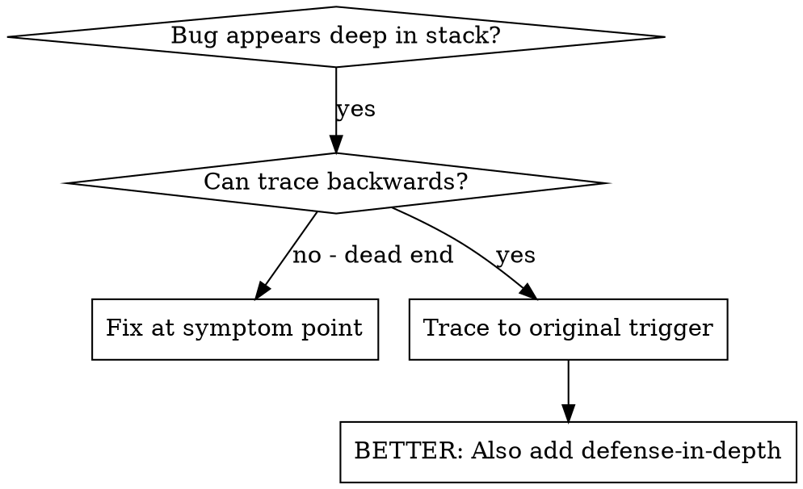
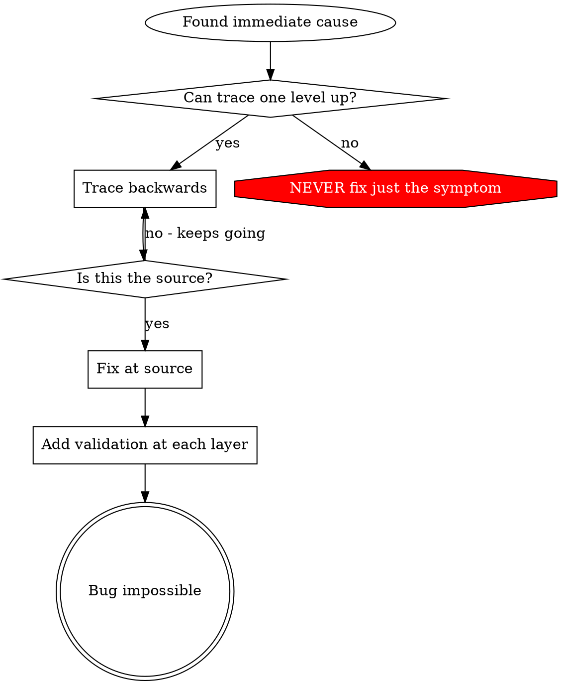

本技能译自 Jesse Vincent 的 Superpowers（MIT）。许可证见上一级文件夹的 `LICENSE-superpowers`。

# 根因追踪

## 概述

bug 常常在调用栈深处显现（在错误目录里 git init、文件创建到错误位置、用错误路径打开数据库）。直觉是在报错的地方修，但那是在治症状。

**核心原则：** 沿调用链反向追踪，直到找到最初的触发点，然后在源头修复。

## 何时使用



**在以下情况使用：**
- 错误发生在执行深处（不在入口）
- 堆栈跟踪显示很长的调用链
- 不清楚无效数据从哪里来
- 需要找出是哪个测试或哪段代码触发了问题

## 追踪过程

### 1. 观察症状
```
Error: git init failed in ~/project/packages/core
```

### 2. 找到直接原因
**哪段代码直接导致了这个？**
```typescript
await execFileAsync('git', ['init'], { cwd: projectDir });
```

### 3. 问：是谁调用了这里？
```typescript
WorktreeManager.createSessionWorktree(projectDir, sessionId)
  → called by Session.initializeWorkspace()
  → called by Session.create()
  → called by test at Project.create()
```

### 4. 继续向上追
**传进来的是什么值？**
- `projectDir = ''`（空字符串！）
- 空字符串作为 `cwd` 会解析为 `process.cwd()`
- 那就是源代码目录！

### 5. 找到最初的触发点
**空字符串从哪里来？**
```typescript
const context = setupCoreTest(); // Returns { tempDir: '' }
Project.create('name', context.tempDir); // Accessed before beforeEach!
```

## 加上堆栈跟踪

无法手动追踪时，加上埋点：

```typescript
// Before the problematic operation
async function gitInit(directory: string) {
  const stack = new Error().stack;
  console.error('DEBUG git init:', {
    directory,
    cwd: process.cwd(),
    nodeEnv: process.env.NODE_ENV,
    stack,
  });

  await execFileAsync('git', ['init'], { cwd: directory });
}
```

**关键：** 在测试里用 `console.error()`（不要用 logger——它可能显示不出来）

**运行并捕获：**
```bash
npm test 2>&1 | grep 'DEBUG git init'
```

**分析堆栈跟踪：**
- 找测试文件名
- 找到触发调用的行号
- 识别模式（同一个测试？同一个参数？）

## 找出是哪个测试造成了污染

如果测试期间出现了某个东西，但你不知道是哪个测试：

使用本目录中的二分脚本 `find-polluter.sh`：

```bash
./find-polluter.sh '.git' 'src/**/*.test.ts'
```

逐个运行测试，在第一个污染者处停下。用法见脚本。

## 真实例子：空的 projectDir

**症状：** `.git` 被创建在 `packages/core/`（源代码）

**追踪链：**
1. `git init` 在 `process.cwd()` 中运行 ← cwd 参数为空
2. WorktreeManager 被以空的 projectDir 调用
3. Session.create() 传入了空字符串
4. 测试在 beforeEach 之前访问了 `context.tempDir`
5. setupCoreTest() 最初返回 `{ tempDir: '' }`

**根因：** 顶层变量初始化时访问了空值

**修复：** 把 tempDir 做成 getter，在 beforeEach 之前访问就抛错

**同时加了纵深防御：**
- 第 1 层：Project.create() 校验目录
- 第 2 层：WorkspaceManager 校验非空
- 第 3 层：NODE_ENV 防护拒绝在 tmpdir 之外 git init
- 第 4 层：在 git init 之前记录堆栈跟踪

## 关键原则



**绝不只在报错的地方修。** 反向追回去，找到最初的触发点。

## 堆栈跟踪提示

**在测试中：** 用 `console.error()`，不要用 logger——logger 可能被抑制
**在操作之前：** 在危险操作之前记日志，而不是等它失败之后
**带上上下文：** 目录、cwd、环境变量、时间戳
**捕获堆栈：** `new Error().stack` 显示完整调用链

## 实际效果

来自调试会话（2025-10-03）：
- 通过 5 层追踪找到根因
- 在源头修复（getter 校验）
- 加了 4 层防御
- 1847 个测试通过，零污染
